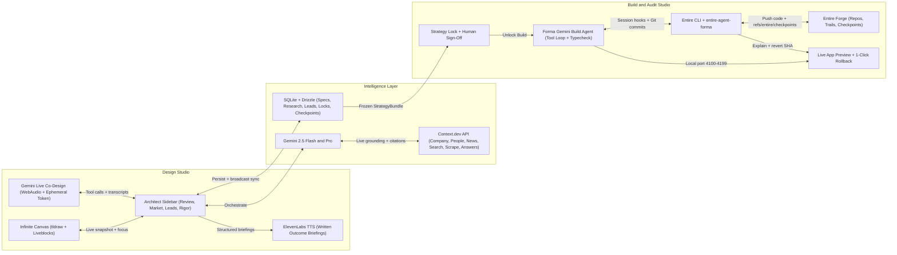
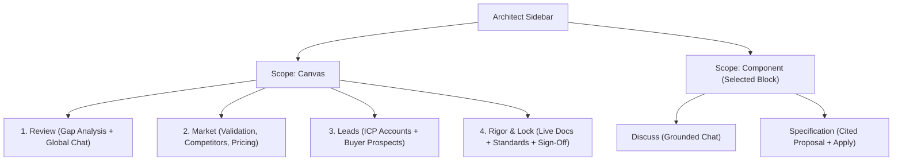
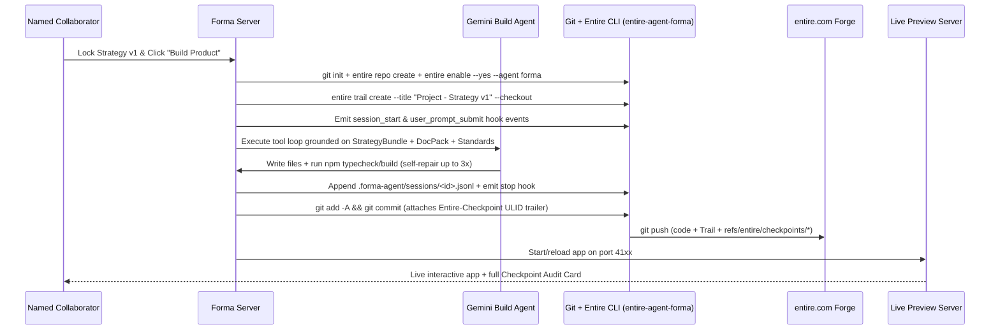

# Forma — Product Architecture, Gap Analysis & Engineering Requirements

## 1. Product Vision & Core Thesis

Frontier AI models changed how we write syntax, not how teams build products. The real bottleneck is connecting **live market truth**, **product requirements**, **engineering rigor**, and **auditable production execution** in one collaborative loop.

**Forma** is a real-time collaborative product studio that takes a team from raw sketch to running, auditable software:
1. **Collaborate & Sketch (`Design` Mode)**: Teams draw flows and semantic system blocks (`screen`, `service`, `database`, `entity`, `decision`, `note`) together on an infinite canvas (`tldraw` + `Liveblocks`), either typing or talking live with **Gemini Live**.
2. **Validate & Ground (`Architect` Flow powered by `Gemini` + `Context.dev`)**:
   - **Market Research**: Live competitor, funding, news, and pricing analysis to verify whether the product has real market pull.
   - **Lead Research**: Real buyer/ICP company and decision-maker lead generation with warm triggers and outreach angles.
   - **Latest Code Documentation**: Up-to-date framework/SDK docs fetched from official documentation domains so coding agents never hallucinate deprecated APIs.
   - **Engineering Standards & Rigor**: Cited industry standards (RFCs, OWASP, idempotency, concurrency, data retention) mapped directly onto canvas components and component specifications.
3. **Lock Strategy (Human Accountability Gate)**: A named collaborator signs off on the frozen **Strategy Bundle** (canvas graph + component specs + pinned market/rigor citations + target stack) before code is written.
4. **Build, Host & Audit (`Build` Mode powered by `Gemini` + `Entire`)**:
   - Forma's **Gemini Build Agent** writes production-hardened code into a per-project Git repository, verifies types/builds, and runs a **Live App Preview** inside Forma.
   - **Entire (`entire.com` + `entire` CLI)** hosts the repository, **Trails**, **Agent Sessions**, and **`Entire-Checkpoint` provenance** (prompts, transcripts, tool calls, token usage, and AI-vs-human line attribution), enabling **1-click checkpoint rollbacks** and direct **human code overrides**.
5. **Listen & Steer (`Hybrid Voice` powered by `Gemini Live` + `ElevenLabs`)**:
   - **Gemini Live** handles low-latency bidirectional voice co-design and hands-free canvas/research tool calls.
   - **ElevenLabs** narrates polished executive audio briefings of written outcomes (Market Reports, Lead Briefs, Component Specs, and Checkpoint Audit summaries).

---

## 2. Current Codebase Status vs. Target Vision (Gap Analysis)

### 2.1 What Is Implemented Today
- **Infinite Canvas & Semantic Blocks**:
  - `src/components/workspace/canvas-stage.tsx`, `src/lib/canvas/forma-block-util.tsx`, `src/lib/canvas/forma-block-view.tsx`, `src/lib/canvas/kinds.ts`
  - Custom `forma-block` shape in `tldraw` v5 (`screen`, `service`, `database`, `entity`, `decision`, `note`), arrow connection extraction (`src/lib/canvas/extract.ts`), and two seeded demo workspaces (`TaskFlow` and `Meeting Notes`).
- **Real-Time Canvas Presence**:
  - `src/lib/liveblocks.ts`, `src/lib/liveblocks.config.ts`, `src/lib/canvas/use-storage-store.ts`, `src/components/workspace/presence.tsx`
  - Multi-browser cursor presence, collaborator avatars, and `tldraw` shape sync via Liveblocks Storage (`Solo` IndexedDB fallback when `LIVEBLOCKS_SECRET_KEY` is unset).
- **Foundational Architect Sidebar**:
  - `src/components/workspace/ai-sidebar.tsx`, `src/lib/ai/provider.ts`, `src/app/api/ai/analyze/route.ts`, `src/app/api/ai/chat/route.ts`, `src/app/api/ai/specify/route.ts`
  - `Canvas` mode (goal textarea, 4–7 gap findings, global streaming chat) and `Component` mode (block title/description, local streaming chat, specification proposal + manual apply).
  - Server-only `@google/genai` (`gemini-2.5-flash` default) and `openai` (`gpt-4.1-mini` fallback).
- **Local SQLite Persistence & Demo Auth**:
  - `src/lib/db/schema.ts`, `src/lib/db/index.ts`, `src/lib/auth.ts`, `src/lib/projects.ts`
  - `better-sqlite3` + `drizzle-orm` storing `users`, `projects`, `specifications`, and `conversations`.

### 2.2 Architectural Gaps to Close
- **Gap 1 — Partial Real-Time Collaboration**:
  - Only `tldraw` shapes sync via Liveblocks.
  - Canvas `Analysis` is stored only in ephemeral React `useState` inside `ArchitectPane` (`src/components/workspace/ai-sidebar.tsx`)—closing the sidebar or refreshing wipes it, and teammates never see it.
  - Edits to `project.goal`, saved `specifications`, and `conversations` do not notify other connected browsers.
- **Gap 2 — Zero Live Grounding (`Context.dev` Missing)**:
  - `src/lib/ai/provider.ts` only runs single-shot `generateContent` / `generateContentStream` with no tool calling, no web retrieval, and no citation data model.
  - None of the 4 Context.dev workflows (Market Research, Lead Research, Latest Code Docs, Cited Engineering Rigor) exist.
- **Gap 3 — No Lifecycle Gate ("Strategy Lock")**:
  - There is no structured readiness check or human sign-off snapshot connecting product/architecture specs to code generation.
- **Gap 4 — No Build Engine, Live App Preview, or `Entire` Integration**:
  - No `Design <-> Build` mode switch in `TopNav` / `Workspace`.
  - No Gemini coding loop, file sandbox, typecheck/build verification, or embedded preview server.
  - No `entire` CLI / `entire.com` integration (`entire repo create`, `entire enable`, `entire trail create`, `entire checkpoint list/explain`, or checkpoint-linked rollbacks).
- **Gap 5 — No Voice Mode**:
  - Zero audio capture, WebSocket streaming, or TTS narration endpoints/UI.

---

## 3. Target System Architecture



---

## 4. Detailed Engineering Requirements

### Pillar A: Collaborative State & Database Schema Expansion

#### A.1 SQLite + Drizzle Schema (`src/lib/db/schema.ts` & `src/lib/db/index.ts`)
Keep existing tables (`users`, `projects`, `specifications`, `conversations`) intact and add:

1. **`analyses`**:
   - `id` (`text` PK), `projectId` (`text` FK -> `projects.id` cascade), `summary` (`text`), `findingsJson` (`text` JSON of `Finding[]`), `createdBy` (`text` FK -> `users.id`), `createdAt` (`integer`).
2. **`research_artifacts`**:
   - `id` (`text` PK), `projectId` (`text` FK), `kind` (`text`: `"market" | "docs" | "standards"`), `title` (`text`), `queryMetaJson` (`text`), `contentJson` (`text`), `citationsJson` (`text` JSON of `Citation[]`), `pinned` (`integer` boolean `0 | 1`), `createdBy` (`text` FK), `createdAt` (`integer`).
3. **`leads`**:
   - `id` (`text` PK), `projectId` (`text` FK), `personName` (`text`), `roleTitle` (`text`), `seniority` (`text`), `companyName` (`text`), `companyDomain` (`text`), `location` (`text`), `profileUrlsJson` (`text`), `skillsJson` (`text`), `matchConfidence` (`real` nullable), `warmTrigger` (`text`), `outreachAngle` (`text`), `status` (`text`: `"new" | "shortlisted" | "contacted" | "archived"`), `createdAt` (`integer`).
4. **`strategy_locks`**:
   - `id` (`text` PK), `projectId` (`text` FK), `version` (`integer`), `status` (`text`: `"locked" | "superseded"`), `lockedByUserId` (`text` FK -> `users.id`), `lockedByName` (`text`), `notes` (`text`), `bundleJson` (`text` — immutable JSON containing `CanvasSnapshot`, all block `Specification`s, pinned `research_artifacts`, and chosen `StackConfig`), `createdAt` (`integer`).
5. **`build_workspaces`**:
   - `projectId` (`text` PK FK -> `projects.id`), `localRepoPath` (`text`), `entireMode` (`text`: `"cloud" | "local-git"`), `entireProject` (`text`), `entireRepoRef` (`text`, e.g. `/et/<project>/<repo>`), `entireRemoteUrl` (`text`, e.g. `entire://...`), `activeTrailId` (`text`), `activeBranch` (`text`), `headCommitSha` (`text`), `previewPort` (`integer` nullable), `previewStatus` (`text`: `"stopped" | "starting" | "running" | "error"`), `updatedAt` (`integer`).
6. **`build_runs`**:
   - `id` (`text` PK), `projectId` (`text` FK), `strategyLockId` (`text` FK -> `strategy_locks.id`), `sessionId` (`text`), `triggerKind` (`text`: `"initial-build" | "steering" | "human-override" | "rollback"`), `prompt` (`text`), `status` (`text`: `"running" | "succeeded" | "failed"`), `stepsJson` (`text`), `verificationLog` (`text`), `checkpointId` (`text` nullable), `commitSha` (`text` nullable), `createdBy` (`text` FK), `createdAt` (`integer`), `completedAt` (`integer` nullable).
7. **`build_checkpoints`**:
   - `id` (`text` PK — `Entire-Checkpoint` ULID or local fallback ID), `projectId` (`text` FK), `buildRunId` (`text` FK nullable), `commitSha` (`text`), `parentCommitSha` (`text` nullable), `authorKind` (`text`: `"agent" | "human" | "rollback"`), `title` (`text`), `summary` (`text`), `requirementIdsJson` (`text` — canvas block IDs addressed), `citationsJson` (`text` — Context.dev doc/standard citations applied), `filesTouchedJson` (`text`), `inputTokens` (`integer`), `outputTokens` (`integer`), `agentAttributionPct` (`integer`), `createdAt` (`integer`).
8. **`audio_cache`**:
   - `hash` (`text` PK — SHA-256 of `voiceId:modelId:normalizedText`), `projectId` (`text` FK), `sourceType` (`text`), `sourceId` (`text`), `scriptText` (`text`), `filePath` (`text` under `data/audio/<hash>.mp3`), `durationEstimateSec` (`integer`), `createdAt` (`integer`).

#### A.2 Real-Time Collaboration Sync (`src/lib/liveblocks.config.ts` & `src/lib/collab/sync-events.ts`)
- Extend `Liveblocks.Presence` with:
  - `workspaceStage`: `"design" | "build"`
  - `architectTab`: `"review" | "market" | "leads" | "rigor" | "component"`
  - `voiceState`: `"idle" | "listening" | "speaking"`
- Define `Liveblocks.RoomEvent`:
  ```ts
  type FormaRoomEvent = {
    type: "RESOURCE_UPDATED";
    resource:
      | "goal"
      | "analysis"
      | "market"
      | "leads"
      | "docs"
      | "standards"
      | "specification"
      | "conversation"
      | "strategy-lock"
      | "build";
    blockId?: string;
    actorId: string;
    actorName: string;
    timestamp: number;
  };
  ```
- Whenever any collaborator mutates a SQLite-backed resource, broadcast `RESOURCE_UPDATED` over Liveblocks `useBroadcastEvent`, triggering `useEventListener` subscribers in peer browsers to re-fetch and show subtle attribution toasts (e.g., *"Sam locked Strategy v2"*).

---

### Pillar B: Architect Flow & `Context.dev` Intelligence Layer

#### B.1 Server-Side `Context.dev` Client (`src/lib/context-dev/client.ts`)
- Install official SDK: `npm install context.dev` (requires Node >= 20; Forma runs Node >= 26).
- Read `CONTEXT_DEV_API_KEY` strictly on the server (`import "server-only"`).
- Configure client with `new ContextDev({ apiKey, timeout: 60_000, maxRetries: 2 })` so `ultra` mode company/people queries (20–30s SLA) do not time out prematurely.
- **Exact Method Mapping to `Context.dev` v1 Endpoints**:
  - **Web Search**: `client.web.search({ query, numResults, includeDomains, excludeDomains, freshness, descriptionMaxCharacters })`
  - **Web Scrape (Markdown)**: `client.web.scrape({ url, formats: { markdown: true }, sharedParams: { mainContentOnly: true } })` (always check `page.markdown?.success` before reading `page.markdown.data`)
  - **Domain Sitemap Discovery**: `client.web.mapUrls({ domain })`
  - **Structured Web Answers**: `client.post("/web/answers", { body: { task, json_format } })`
  - **Company Search**: `client.post("/company/search", { body: { query, mode: "ultra", filters } })`
  - **People Search**: `client.people.search({ query, mode: "ultra", filters: { countries, years_of_experience_min, years_of_experience_max } })`
  - **Company & Topic News**: `client.news.search({ searchBy: { type: "natural_language", query } | { type: "entity", entity: { type: "domain", domain } }, limit })`
  - **Brand Metadata**: `client.brand.retrieve({ type: "by_domain", domain })`
- **Unified Citation Schema (`src/lib/ai/schemas.ts`)**:
  ```ts
  export const citationSchema = z.object({
    id: z.string(),
    title: z.string(),
    url: z.string().url(),
    domain: z.string(),
    sourceKind: z.enum(["company", "news", "docs", "standard", "pricing", "profile"]),
    snippet: z.string(),
    publishedOrUpdatedAt: z.string().nullable(),
    retrievedAt: z.number(),
  });
  ```

#### B.2 Architect Sidebar Information Architecture (`src/components/workspace/ai-sidebar.tsx`)
Retain the crisp two-scope mental model (`Canvas` vs. `Component`), add an expand/collapse width toggle (`420px` <-> `580px`), and organize `Canvas` into four focused sub-tabs:



#### B.3 Feature 1: Market Research (`POST /api/ai/research/market`)
- **Purpose**: Validate whether the product on the canvas solves a real, under-served problem or walks into a saturated commodity trap.
- **Execution Pipeline**:
  1. **Canvas Extraction & Query Plan (Gemini)**: Reads `project.goal`, `CanvasSnapshot` (especially `note` and `decision` blocks like `Pricing model` or `Product intent`), and outputs targeted company, news, and pricing search queries.
  2. **Parallel Context.dev Retrieval**:
     - `POST /company/search` (`mode: "ultra"`) for 8–10 direct and adjacent competitors (captures HQ, headcount, funding, domain).
     - `client.news.search` (`natural_language` market trend query + top 3 competitor `domain` entity lookups) for funding velocity and recent launches.
     - `client.web.search` (`query: "<competitor> pricing"`, `freshness: "last_year"`) + `client.web.scrape` (`markdown: true`) on top pricing/product pages + `client.brand.retrieve` for competitor brand metadata.
  3. **Grounded Synthesis (Gemini JSON)**: Produces `MarketReport`:
     - `demandVerdict`: `"strong-pull" | "crowded-wedge-needed" | "unproven-niche" | "weak"`
     - `executiveSummary`: Concise thesis with inline `[citationId]` markers
     - `competitors[]`: `{ name, domain, headcount, fundingSummary, positioning, pricingModel, strengths[], weaknesses[], citationIds[] }`
     - `marketSignals[]`: `{ signal, implication, citationIds[] }`
     - `recommendedWedge`: Concrete positioning + pricing recommendation mapped back to open `decision` blocks on the canvas
     - `killRisks[]`: Honest reasons this startup could fail and how to test them fast
     - `citations[]`: Verified `Citation[]`
- **Canvas Integration**: One-click **"Apply to Decision Block"** updates undecided canvas blocks (e.g., `Pricing model` in `Meeting Notes`) after user confirmation.

#### B.4 Feature 2: Lead Research (`POST /api/ai/research/leads`)
- **Purpose**: Generate real initial customer leads and design-partner prospects before writing a single line of code.
- **Execution Pipeline**:
  1. **ICP Form + Auto-Suggestion**: Gemini pre-populates an editable ICP card (`targetCompanyQuery`, `buyerPersonaQuery`, `countries[]`, `minExperienceYears`) from the canvas + latest `MarketReport`.
  2. **Context.dev Company + People Pipeline**:
     - `POST /company/search` (`mode: "ultra"`, `filters`) to identify high-fit target companies.
     - `client.people.search` (`mode: "ultra"`, `filters: { countries, years_of_experience_min }`) to retrieve matching buyers (`name`, `role.title`, `role.company.name`, `role.company.domain`, `profiles[]`, `skills[]`, `match.confidence`).
     - `client.news.search` (`entity` by `role.company.domain`) on top matches to surface a timely **"Why Now" trigger** (recent round, expansion, hiring, product launch).
  3. **Outreach Synthesis (Gemini JSON)**: Generates a personalized, non-spammy 2-sentence design-partner outreach hook grounded in the canvas value proposition and the prospect's role/company signal.
- **UI Actions**: Filter by status (`New`, `Shortlisted`, `Contacted`), copy outreach message, open verified LinkedIn/profile URLs, and **Export CSV / JSON**.

#### B.5 Feature 3: Latest Code Documentation (`POST /api/ai/research/docs`)
- **Purpose**: Eliminate hallucinated imports, outdated framework conventions, and deprecated SDK calls during spec drafting and code generation.
- **Execution Pipeline**:
  1. **Stack Resolution**: Infers required libraries/APIs from canvas blocks + project stack selector (e.g., `next`, `drizzle-orm`, `zod`, `@google/genai`, `stripe`, `deepgram`, etc.).
  2. **Context.dev Official-Docs Retrieval**:
     - Maps official docs domains via `client.web.mapUrls` or queries `client.web.search` with `includeDomains` pinned to authoritative documentation hosts and `freshness: "last_year"`.
     - Scrapes top matching reference pages via `client.web.scrape({ url, formats: { markdown: true }, sharedParams: { mainContentOnly: true } })`.
  3. **Distillation into `DocPack` (`research_artifacts` kind `"docs"`)**:
     - `packageName`, `versionOrEra`, `officialDocsUrl`, `verifiedImports[]`, `canonicalUsageSnippets[]`, `breakingChangesAndDeprecations[]`, `citations[]`.

#### B.6 Feature 4: Standard Engineering Implementations & Rigor (`POST /api/ai/research/standards`)
- **Purpose**: Ground architecture and code in battle-tested engineering standards with verifiable citations rather than generic LLM boilerplate.
- **Execution Pipeline**:
  1. **Architectural Surface Extraction**: Inspects canvas blocks and arrows for critical boundaries: authentication/sessions, webhooks/retries, external API failure modes, database concurrency/transactions, PII/GDPR retention, rate limiting, and observability.
  2. **Context.dev Standards Retrieval**:
     - Runs `POST /web/answers` and `client.web.search` + `client.web.scrape` targeting authoritative engineering sources (`datatracker.ietf.org`, `cheatsheetseries.owasp.org`, `12factor.net`, official cloud/database architecture guides, vendor engineering docs).
  3. **Synthesis into `EngineeringStandardsPack` (`research_artifacts` kind `"standards"`)**:
     - `standards[]`: `{ id, title, category, appliesToBlockIds[], mustHoldInvariants[], failureModeHandling[], implementationChecklist[], citations[] }`.
- **Grounded Component Specifications (`POST /api/ai/specify`)**:
  - Upgrade `specificationSchema` in `src/lib/ai/schemas.ts` to add `verificationCriteria: z.array(z.string()).default([])` and `citations: z.array(citationSchema).default([])` (backward-compatible with existing saved specs).
  - Inject pinned `DocPack` and `EngineeringStandardsPack` into `/api/ai/specify` and `/api/ai/chat` so component specifications cite exact standards and current library APIs.

#### B.7 Strategy Lock Gate (`POST /api/projects/[projectId]/lock`)
- **Readiness Checklist UI** inside `Rigor & Lock`:
  - Project Goal defined
  - Canvas has >= 1 semantic block and no unresolved `critical` findings (or explicitly acknowledged residual risk)
  - Market Research artifact reviewed/pinned (optional override with reason)
  - Component Specifications saved for core blocks
  - Latest Docs + Engineering Standards packs generated
- Clicking **"Lock Strategy vN & Open Build Studio"** records a named human sign-off (`lockedByUserId`, `lockedByName`, timestamp, immutable `StrategyBundle`) and switches the workspace to **`Build`**.

---

### Pillar C: Build Studio, `Entire` Hosting, Audit Trail & Live Preview

#### C.1 Workspace Top-Level Flow (`src/components/workspace/top-nav.tsx` & `src/components/workspace/workspace.tsx`)
- Add a central segmented switch in `TopNav`:
  - **`Design`** — Infinite Canvas + Left Toolbar + Architect Sidebar + Voice Bar.
  - **`Build`** — Split studio layout:
    - **Left Pane**: Build Agent Console (live SSE step stream + steering prompt bar) & **Entire Audit Timeline** (checkpoints, requirement trace, citations, AI/human attribution, 1-click rollback).
    - **Center/Right Pane**: Segmented view between **Live App Preview** (`iframe` to running generated app), **Code & Diff Inspector** (with **Human Direct Edit & Commit**), and **Strategy Lock Contract**.

#### C.2 `Entire` (`entire.com`) Integration & Agent Protocol v1 (`bin/entire-agent-forma` + `src/lib/entire/service.ts`)



- **Custom Agent Executable (`bin/entire-agent-forma`)**:
  - Executable Node script implementing the **Entire Agent Integration Protocol (`protocol_version: 1`)** so Entire natively recognizes Forma's Gemini Build Agent (`entire enable --yes --agent forma`):
    - Required subcommands: `info` (`name: "forma"`, `protected_dirs: [".entire", ".forma-agent"]`, `capabilities: { hooks: true, transcript_analyzer: true, token_calculator: true }`), `detect`, `get-session-id`, `get-session-dir`, `resolve-session-file`, `read-session`, `write-session`, `read-transcript`, `chunk-transcript`, `reassemble-transcript`, `format-resume-command`.
    - Capability subcommands: `parse-hook`, `install-hooks`, `uninstall-hooks`, `are-hooks-installed`, `get-transcript-position`, `extract-modified-files`, `extract-prompts`, `extract-summary`, `calculate-tokens`.
- **`EntireService` (`src/lib/entire/service.ts`)**:
  - Prepends `path.join(process.cwd(), "bin")` to `process.env.PATH` for all child commands.
  - **Cloud Mode (when `entire` CLI is installed and authenticated)**:
    - Provisioning: `entire repo create <slug> --project <ENTIRE_PROJECT>` (if not yet created), sets `entire://...` remote, runs `entire enable --yes --agent forma`, and creates/switches Trail via `entire trail create --title "<title>" --checkout`.
    - Audit Queries: `entire checkpoint list --json` and `entire checkpoint explain <checkpointId> --json` to hydrate Forma's UI with native Entire checkpoint metadata, transcripts, and token breakdowns.
    - Push: `git push -u origin <branch>` (automatically uploads `refs/entire/checkpoints/*` alongside commits).
  - **Local-Git Fallback Mode (zero-blocker resilience when `entire` binary or login is absent)**:
    - Still initializes a real Git repository in `data/workspaces/<projectId>/repo`, writes identical `.forma-agent/sessions/<sessionId>.jsonl` transcripts, adds `Forma-Strategy-Lock` and `Entire-Checkpoint` compatible commit trailers, and records full provenance in `build_checkpoints`. As soon as the user installs/logs into `entire`, a **"Connect & Push to entire.com"** button runs `entire import` / `entire enable` and syncs the repo seamlessly.

#### C.3 Forma Gemini Build Agent (`src/lib/ai/builder.ts`)
- **Model**: `@google/genai` using `GEMINI_BUILD_MODEL` (defaults to `gemini-2.5-pro`, falling back to `GEMINI_MODEL`).
- **Context Contract**:
  - System instruction enforces strict adherence to `.forma/STRATEGY_LOCK.json`, `.forma/DOC_PACK.md` (Context.dev live docs), and `.forma/ENGINEERING_STANDARDS.md` (cited rigor checklists).
  - Requires mapping every generated module back to canvas `blockId`s so checkpoints explain *which product block* each file implements.
- **Sandboxed Function Declarations**:
  - `list_files()`, `read_file({ path })`, `write_file({ path, content, relatedBlockIds, appliedCitationIds })`, `delete_file({ path })` — strictly confined via `path.resolve` prefix validation to `data/workspaces/<projectId>/repo` and blocking writes to `.git/`, `.entire/`, or `.env*`.
  - `lookup_live_docs({ query, domains })` — on-demand Context.dev `web.search` + `web.scrape` if the agent encounters an unfamiliar library edge case mid-build.
  - `verify_project()` — runs `npm install` (when `package.json` changes) and `npm run typecheck && npm run build` with a hard 90s timeout, returning compiler/linter diagnostics for up to 3 autonomous repair turns before commit.
- **Human Control & Overrides (`POST /api/build/override`)**:
  - Users can edit any file directly in Forma's **Code & Diff Inspector** and click **"Save & Commit Override"**, or send a steering instruction (**"Steer Agent"**) to refine specific components.
  - Human overrides commit directly via Git *without* invoking `entire hooks forma` agent turn markers, preserving accurate human-vs-AI line attribution in Entire.

#### C.4 Live App Preview & 1-Click Instant Rollback (`src/lib/build/preview-manager.ts` & `POST /api/build/rollback`)
- **Preview Server Manager**:
  - Singleton process registry (`globalThis.formaPreviewServers`) managing child `npm run dev -- --port <port>` processes across ports `4100–4199`.
  - Health-polls `http://127.0.0.1:<port>` until ready, exposes status via `GET /api/build/preview?projectId=...`, and cleans up orphan processes on workspace stop or server shutdown.
- **1-Click Checkpoint Rollback**:
  - Selecting any historical checkpoint in the **Entire Audit Timeline** and clicking **"Rollback to this Checkpoint"**:
    1. Creates a deterministic revert/restore commit restoring the tree to `<targetCommitSha>` (`git checkout <targetCommitSha> -- . && git commit -m "Rollback to checkpoint <id>"`).
    2. Records a `rollback` entry in `build_checkpoints` referencing the rolled-back checkpoint and reason.
    3. Pushes the rollback commit to `entire.com` and hot-reloads the Live App Preview.

---

### Pillar D: Hybrid Voice Mode (`Gemini Live` + `ElevenLabs`)

#### D.1 Interactive Co-Design via `Gemini Live` (`src/lib/voice/gemini-live.ts` & `src/components/workspace/voice-bar.tsx`)
- **Server Ephemeral Token Route (`POST /api/voice/gemini-token`)**:
  - Authenticates the signed-in Forma user and mints a short-lived single-use ephemeral token using `@google/genai` on `v1alpha`:
    ```ts
    const serverAi = new GoogleGenAI({
      apiKey: process.env.GEMINI_API_KEY,
      httpOptions: { apiVersion: "v1alpha" },
    });
    const token = await serverAi.authTokens.create({
      config: {
        uses: 1,
        newSessionExpireTime: new Date(Date.now() + 60_000).toISOString(),
        expireTime: new Date(Date.now() + 30 * 60_000).toISOString(),
      },
    });
    ```
  - Never exposes `GEMINI_API_KEY` to the browser.
- **Browser Bidirectional Audio & Tool Session**:
  - Connects via `new GoogleGenAI({ apiKey: token.name, httpOptions: { apiVersion: "v1alpha" } }).live.connect(...)` using `GEMINI_LIVE_MODEL` (`gemini-live-2.5-flash-preview` default) with `responseModalities: [Modality.AUDIO]`, `inputAudioTranscription: {}`, and `outputAudioTranscription: {}`.
  - Streams 16kHz PCM microphone input via `AudioWorkletNode`, plays 24kHz PCM model audio with instant **barge-in** buffer clearing when the user interrupts.
  - **Live Function Calling Tools**:
    - `get_canvas_context()`: Returns current `CanvasSnapshot`, selected block, and latest findings/market summary.
    - `focus_canvas_block({ blockId })`: Selects and zooms the `tldraw` camera to a block while talking about it.
    - `propose_canvas_block({ kind, title, description, connectFromBlockId })`: Shows a non-destructive confirmation pill on the canvas/sidebar to place a new block.
    - `run_architect_research({ kind: "analyze" | "market" | "leads" | "docs" | "standards" })`: Triggers any Architect research flow hands-free and announces completion.
  - Appends finalized spoken user/assistant transcripts into the workspace's `conversations` history so written and spoken context stay unified.

#### D.2 Written-Outcome Audio Briefings via `ElevenLabs` (`src/lib/voice/elevenlabs.ts` & `POST /api/voice/narrate`)
- Install `@elevenlabs/elevenlabs-js` (or stream directly via `https://api.elevenlabs.io/v1/text-to-speech/${voiceId}/stream?output_format=mp3_44100_128`).
- **Outcome-to-Briefing Script Formatter**:
  - Before calling TTS, formats structured JSON outcomes (`MarketReport`, `Leads` top matches, `Component Specification`, `Analysis`, or `Entire Checkpoint` explanation) into a crisp 30–60 second spoken executive summary (stripping raw URLs, IDs, and markdown noise).
- **Streaming + Disk Cache**:
  - Computes SHA-256 over `(voiceId, modelId, scriptText)`.
  - Cache hit in `audio_cache` -> serves `data/audio/<hash>.mp3` immediately with zero ElevenLabs credit spend.
  - Cache miss -> streams `audio/mpeg` chunks to the browser `<audio>` player while teeing bytes to `data/audio/<hash>.mp3`.
- **UI Placement**: Compact **`Listen`** button (`Volume2` icon + waveform progress + `1x / 1.25x` toggle) in the header of Market Research, Lead Research, Canvas Review, Component Specification, and Build Checkpoint cards.

---

## 5. API Route & File Blueprint

### New & Updated API Routes
- `POST /api/ai/analyze` *(update)* — Persist `Analysis` to SQLite and include saved research context.
- `POST /api/ai/specify` *(update)* — Ground component spec proposals in `DocPack` + `EngineeringStandardsPack` with `citations[]` and `verificationCriteria[]`.
- `GET / POST /api/ai/research/market` *(new)* — Fetch latest or run live Context.dev Market Validation.
- `GET / POST / PATCH /api/ai/research/leads` *(new)* — List/export leads, run Context.dev ICP + People + News pipeline, update lead status.
- `GET / POST /api/ai/research/docs` *(new)* — Generate/retrieve Context.dev `DocPack` for target tech stack.
- `GET / POST /api/ai/research/standards` *(new)* — Generate/retrieve cited `EngineeringStandardsPack` for canvas architecture.
- `GET / POST /api/projects/[projectId]/lock` *(new)* — Read lock history or sign off on a new `StrategyBundle`.
- `GET / POST /api/build/workspace` *(new)* — Inspect/provision project Git repo, Entire repo/trail status, and file tree.
- `POST /api/build/run` *(new)* — SSE streaming endpoint running the Forma Gemini Build Agent + verification + Entire checkpoint commit/push.
- `POST /api/build/override` *(new)* — Save & commit direct human file edits without AI attribution.
- `GET /api/build/checkpoints` *(new)* — List and explain checkpoints (merging `entire checkpoint list/explain --json` with SQLite requirement & citation trace).
- `POST /api/build/rollback` *(new)* — Revert repo to selected checkpoint SHA, push to Entire, and reload preview.
- `GET / POST / DELETE /api/build/preview` *(new)* — Start, health-check, or stop the generated app's local preview server.
- `POST /api/voice/gemini-token` *(new)* — Mint `v1alpha` ephemeral token for Gemini Live WebSockets.
- `POST /api/voice/narrate` *(new)* — Stream & cache ElevenLabs TTS audio briefings of written outcomes.

### Key New Modules & Components
- `src/lib/context-dev/client.ts` — Typed Context.dev SDK wrapper, retry/timeout handling, and citation normalizer.
- `src/lib/context-dev/pipelines/{market,leads,docs,standards}.ts` — Domain pipelines combining Gemini query planning + Context.dev retrieval + cited synthesis.
- `bin/entire-agent-forma` — Executable Entire Agent Integration Protocol v1 adapter.
- `src/lib/entire/service.ts` — Entire CLI / `entire.com` repo, trail, session, checkpoint, and local-Git fallback orchestrator.
- `src/lib/ai/builder.ts` — Gemini tool-calling code generator + compiler verification self-repair loop.
- `src/lib/build/preview-manager.ts` — Port allocator (`4100–4199`) and child dev-server lifecycle manager.
- `src/lib/voice/gemini-live.ts` & `src/components/workspace/voice-bar.tsx` — Gemini Live WebAudio + tool-calling bar.
- `src/lib/voice/elevenlabs.ts` & `src/components/workspace/narrate-button.tsx` — Cached ElevenLabs outcome audio player.
- `src/components/workspace/architect/{market-tab,leads-tab,rigor-tab}.tsx` — Modular Architect sub-views inside `ai-sidebar.tsx`.
- `src/components/workspace/build-studio.tsx` — Build Studio workspace (Agent stream, Live Preview iframe, Code/Diff override editor, Entire Audit Timeline & Rollback).

---

## 6. Environment Variables & Dependencies

### Dependencies to Add (`package.json`)
- `context.dev` — Official Context.dev TypeScript SDK
- `@elevenlabs/elevenlabs-js` — Official ElevenLabs TypeScript SDK

### Environment Variables (`.env.example` / `.env.local`)
```bash
# Core LLM & Live Voice (Gemini backbone)
GEMINI_API_KEY=
GEMINI_MODEL=gemini-2.5-flash
GEMINI_BUILD_MODEL=gemini-2.5-pro
GEMINI_LIVE_MODEL=gemini-live-2.5-flash-preview

# Real-Time Web, Company, People, News & Docs Intelligence
CONTEXT_DEV_API_KEY=

# Spoken Briefings of Written Outcomes
ELEVENLABS_API_KEY=
ELEVENLABS_VOICE_ID=JBFqnCBsd6RMkjVDRZzb

# Entire (entire.com) Code Hosting, Trails & Checkpoints
ENTIRE_OWNER=
ENTIRE_PROJECT=

# Real-Time Canvas & Artifact Collaboration
LIVEBLOCKS_SECRET_KEY=
```

---

## 7. Phased Implementation Roadmap & Acceptance Criteria

### Phase 1: Persistence Foundation & Real-Time Artifact Sync
- [ ] Expand `src/lib/db/schema.ts` and `src/lib/db/index.ts` with `analyses`, `research_artifacts`, `leads`, `strategy_locks`, `build_workspaces`, `build_runs`, `build_checkpoints`, and `audio_cache`.
- [ ] Persist `/api/ai/analyze` results to `analyses` and load the latest analysis on sidebar mount.
- [ ] Add Liveblocks `RESOURCE_UPDATED` broadcast events and collaborator stage/tab presence in `src/lib/liveblocks.config.ts`.
- **Acceptance**: Two browsers open on `Meeting Notes` see live updates when either teammate edits the goal, runs Canvas Analysis, or saves a Component Specification.

### Phase 2: `Context.dev` Intelligence & Architect Flow Redesign
- [ ] Install `context.dev` and build `src/lib/context-dev/client.ts` with unified citation extraction and graceful missing-key diagnostics.
- [ ] Build `/api/ai/research/market`, `/api/ai/research/leads`, `/api/ai/research/docs`, and `/api/ai/research/standards`.
- [ ] Upgrade `/api/ai/specify` so component proposals include `verificationCriteria[]` and `citations[]` grounded in the project's `DocPack` and `EngineeringStandardsPack`.
- [ ] Redesign `src/components/workspace/ai-sidebar.tsx` with `Review`, `Market`, `Leads`, and `Rigor & Lock` tabs plus `/api/projects/[projectId]/lock`.
- **Acceptance**: On `Meeting Notes`, running Market Research surfaces real meeting-AI competitors and pricing citations; Lead Research returns real B2B prospects with CSV export; Docs & Standards attach live citations to component specs; locking Strategy creates `Strategy Lock v1`.

### Phase 3: Build Studio, `Entire` Hosting, Audit Trail & Live Preview
- [ ] Implement `bin/entire-agent-forma` (Agent Integration Protocol v1) and `src/lib/entire/service.ts` (Entire Cloud + Local-Git fallback).
- [ ] Implement `src/lib/ai/builder.ts` (Gemini function-calling builder + sandboxed file ops + `typecheck`/`build` self-repair loop) and `POST /api/build/run` SSE stream.
- [ ] Implement `src/lib/build/preview-manager.ts` and `src/components/workspace/build-studio.tsx` with `Design | Build` switcher in `TopNav`, embedded Live App Preview, Human Code Override editor, Entire Checkpoint Inspector, and 1-Click Rollback.
- **Acceptance**: Locking strategy and clicking **Build** scaffolds & compiles a working web app, records a checkpoint (pushing to `entire.com` when authenticated), renders the live app in the preview pane, distinguishes human file overrides from agent commits, and rolls back cleanly in one click.

### Phase 4: Hybrid Voice Mode (`Gemini Live` + `ElevenLabs`)
- [ ] Implement `POST /api/voice/gemini-token` (`v1alpha` ephemeral token) and `VoiceBar` (`ai.live.connect` + PCM WebAudio + barge-in + canvas/research tool calls + transcript sync).
- [ ] Implement `POST /api/voice/narrate` (`@elevenlabs/elevenlabs-js` streaming + `audio_cache`) and attach `NarrateButton` to Market, Leads, Review, Spec, and Checkpoint views.
- **Acceptance**: User can speak to the Architect to inspect blocks or trigger Market Research hands-free, and click **Listen** on any written report or checkpoint to hear an instant ElevenLabs executive briefing.

### Phase 5: Hardening & End-to-End Verification
- [ ] Update `.env.example` and `README.md` with setup instructions for `Context.dev`, `Entire` CLI, `Gemini Live`, and `ElevenLabs`.
- [ ] Run `npm run typecheck`, `npm run lint`, and `npm run build` with zero errors.
