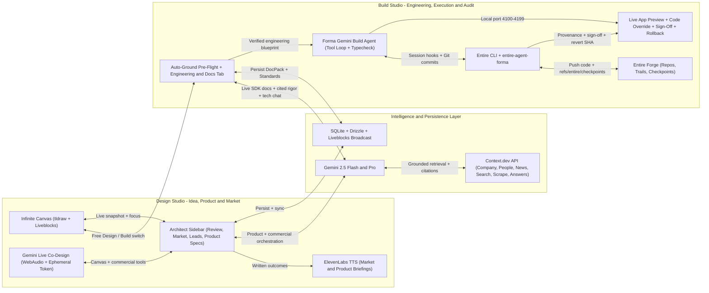
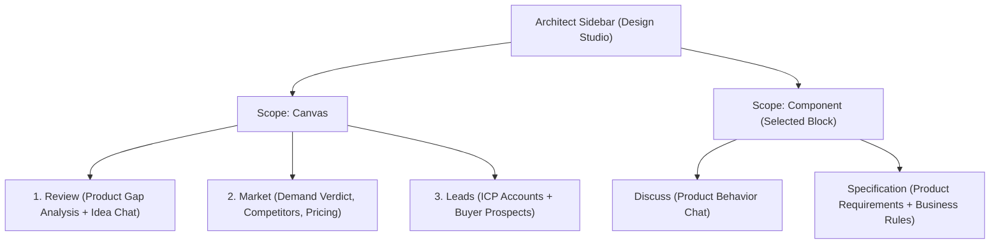
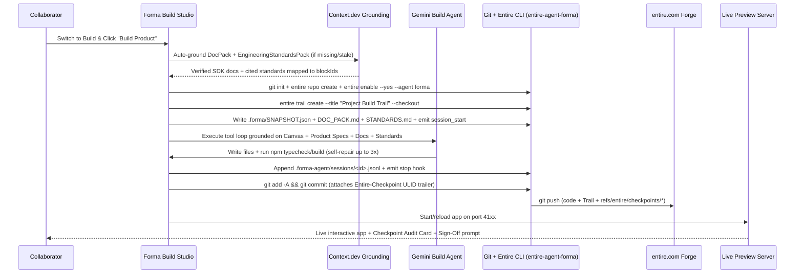

# Forma — Product Architecture, Gap Analysis & Engineering Requirements

## 1. Product Vision & Two-Studio Thesis

Frontier AI models changed how we write syntax, not how teams build products. The real bottleneck is connecting **live market truth**, **product requirements**, **engineering rigor**, and **auditable production execution** in one collaborative loop — without drowning founders in engineering jargon while they are still shaping the business.

**Forma** is a real-time collaborative product studio organized around a crisp **Two-Studio Mental Model** with **free `Design <-> Build` switching**:

1. **Collaborate & Sketch (`Design` Studio — Infinite Canvas)**:
   - Teams draw flows and semantic system blocks (`screen`, `service`, `database`, `entity`, `decision`, `note`) together on an infinite canvas (`tldraw` + `Liveblocks`), either typing or talking live with **Gemini Live**.
2. **Validate the Idea & Business (`Architect` Sidebar in `Design` Studio, powered by `Gemini` + `Context.dev`)**:
   - Focused strictly on **What, Why, and For Whom** — zero SDK deprecations, framework internals, or RFC jargon side-by-side with commercial discovery:
     - **Product Review**: Gap analysis across user flows, ambiguous product logic, and open business decisions, paired with global product chat.
     - **Market Research**: Live competitor, funding, news, and pricing analysis to verify whether the idea has real commercial pull and to settle open `decision` blocks (such as pricing).
     - **Lead Research**: Real buyer/ICP company and decision-maker lead generation with warm triggers, personalized outreach angles, and CSV/JSON export.
     - **Product Specifications**: Per-component product contracts (`purpose`, `functionalRequirements`, `businessRules`, `edgeCases`, `openQuestions`, `architecturalDecisions`).
3. **Switch Freely (`Design <-> Build` Toggle)**:
   - Collaborators move freely between `Design` and `Build` in `TopNav` with no blocking gate inside `Architect`. Canvas edits after a build surface a non-blocking *"Canvas updated since Checkpoint #N — Rebuild & Re-ground"* prompt in `Build Studio`.
4. **Auto-Ground, Build, Host & Sign Off (`Build Studio`, powered by `Gemini` + `Context.dev` + `Entire`)**:
   - Focused on **How It Is Built, Verified, and Audited**:
     - **Autopilot Pre-Flight + `Engineering & Docs` Tab (`Context.dev`)**: Clicking **Build** automatically resolves the stack from canvas blocks, fetches latest official framework/SDK documentation (`DocPack`) so agents never hallucinate deprecated APIs, and pulls cited industry standards (`EngineeringStandardsPack`: RFCs, OWASP, idempotency, webhook verification, concurrency, data retention) mapped to canvas `blockId`s. Non-technical founders get production rigor automatically, while technical collaborators can open the dedicated **`Engineering & Docs`** tab to inspect citations, customize the stack, or discuss technical trade-offs.
     - **Build, Live Preview & `Entire` Provenance**: Forma's **Gemini Build Agent** writes verified code into a per-project Git repository, runs a **Live App Preview** inside Forma, and records **Trails**, **Agent Sessions**, and **`Entire-Checkpoint` provenance** on **`entire.com`** (with local-Git fallback) — supporting direct **human code overrides**, **1-click checkpoint rollbacks**, and **named human sign-off** inside `Build Studio`.
5. **Listen & Steer (`Hybrid Voice` powered by `Gemini Live` + `ElevenLabs`)**:
   - **Gemini Live** handles low-latency bidirectional voice co-design and hands-free canvas/commercial research tool calls in `Design` Studio.
   - **ElevenLabs** narrates polished executive audio briefings of written outcomes across both studios (Market Reports, Lead Briefs, Product Specs, Engineering Blueprints, and Checkpoint Audit summaries).

> **Canonical Showcase Workspaces**: `TaskFlow` (collaborative SaaS seed), `Meeting Notes` (B2B AI pipeline seed), and [`SlotGuard`](./demo_product.md) (flagship non-technical founder commercial business seed).

---

## 2. Current Codebase Status vs. Target Vision (Gap Analysis)

### 2.1 What Is Implemented Today
- **Infinite Canvas & Semantic Blocks**:
  - `src/components/workspace/canvas-stage.tsx`, `src/lib/canvas/forma-block-util.tsx`, `src/lib/canvas/forma-block-view.tsx`, `src/lib/canvas/kinds.ts`
  - Custom `forma-block` shape in `tldraw` v5 (`screen`, `service`, `database`, `entity`, `decision`, `note`), arrow connection extraction (`src/lib/canvas/extract.ts`), and seeded demo workspaces (`TaskFlow` and `Meeting Notes`).
- **Real-Time Canvas Presence**:
  - `src/lib/liveblocks.ts`, `src/lib/liveblocks.config.ts`, `src/lib/canvas/use-storage-store.ts`, `src/components/workspace/presence.tsx`
  - Multi-browser cursor presence, collaborator avatars, and `tldraw` shape sync via Liveblocks Storage (`Solo` IndexedDB fallback when `LIVEBLOCKS_SECRET_KEY` is unset).
- **Foundational Architect Sidebar**:
  - `src/components/workspace/ai-sidebar.tsx`, `src/lib/ai/provider.ts`, `src/app/api/ai/analyze/route.ts`, `src/app/api/ai/chat/route.ts`, `src/app/api/ai/specify/route.ts`
  - `Canvas` mode (goal textarea, 4–7 gap findings, global streaming chat) and `Component` mode (block title/description, local streaming chat, product specification proposal + manual apply).
  - Server-only `@google/genai` (`gemini-2.5-flash` default) and `openai` (`gpt-4.1-mini` fallback).
- **Local SQLite Persistence & Demo Auth**:
  - `src/lib/db/schema.ts`, `src/lib/db/index.ts`, `src/lib/auth.ts`, `src/lib/projects.ts`
  - `better-sqlite3` + `drizzle-orm` storing `users`, `projects`, `specifications`, and `conversations`.

### 2.2 Architectural Gaps to Close
- **Gap 1 — Partial Real-Time Collaboration**:
  - Only `tldraw` shapes sync via Liveblocks.
  - Canvas `Analysis` is stored only in ephemeral React `useState` inside `ArchitectPane` (`src/components/workspace/ai-sidebar.tsx`) — closing the sidebar or refreshing wipes it, and teammates never see it.
  - Edits to `project.goal`, saved `specifications`, `conversations`, research reports, and build status do not notify other connected browsers.
- **Gap 2 — Zero Live Grounding (`Context.dev` Missing)**:
  - `src/lib/ai/provider.ts` only runs single-shot `generateContent` / `generateContentStream` with no tool calling, no web retrieval, and no citation data model.
  - Neither the **Architect commercial workflows** (Market Research, Lead Research) nor the **Build Studio engineering workflows** (Latest Code Docs, Cited Engineering Rigor) exist yet.
- **Gap 3 — No Build Studio, Auto-Grounded Engineering Layer, Live Preview, `Entire` Integration, or Human Sign-Off**:
  - No `Design <-> Build` mode switch in `TopNav` / `Workspace`.
  - No `Engineering & Docs` workbench or auto-grounding pre-flight pipeline.
  - No Gemini coding loop, file sandbox, typecheck/build verification, or embedded preview server.
  - No `entire` CLI / `entire.com` integration (`entire repo create`, `entire enable`, `entire trail create`, `entire checkpoint list/explain`, checkpoint rollbacks, or named human checkpoint sign-off).
- **Gap 4 — No Voice Mode**:
  - Zero audio capture, WebSocket streaming, or TTS narration endpoints/UI.

---

## 3. Target System Architecture



---

## 4. Detailed Engineering Requirements

### Pillar A: Collaborative State & Database Schema Expansion

#### A.1 SQLite + Drizzle Schema (`src/lib/db/schema.ts` & `src/lib/db/index.ts`)
Keep existing tables (`users`, `projects`, `specifications`, `conversations`) intact and add:

1. **`analyses`**:
   - `id` (`text` PK), `projectId` (`text` FK -> `projects.id` cascade), `summary` (`text`), `findingsJson` (`text` JSON of `Finding[]`), `createdBy` (`text` FK -> `users.id`), `createdAt` (`integer`).
2. **`research_artifacts`**:
   - `id` (`text` PK), `projectId` (`text` FK), `kind` (`text`: `"market" | "docs" | "standards"` — `"market"` belongs to `Architect`; `"docs"` and `"standards"` belong to `Build Studio`), `title` (`text`), `inputHash` (`text` — SHA-256 of input context so Build autopilot detects staleness), `queryMetaJson` (`text`), `contentJson` (`text`), `citationsJson` (`text` JSON of `Citation[]`), `pinned` (`integer` boolean `0 | 1`), `createdBy` (`text` FK), `createdAt` (`integer`).
3. **`leads`**:
   - `id` (`text` PK), `projectId` (`text` FK), `personName` (`text`), `roleTitle` (`text`), `seniority` (`text`), `companyName` (`text`), `companyDomain` (`text`), `location` (`text`), `profileUrlsJson` (`text`), `skillsJson` (`text`), `matchConfidence` (`real` nullable), `warmTrigger` (`text`), `outreachAngle` (`text`), `status` (`text`: `"new" | "shortlisted" | "contacted" | "archived"`), `createdAt` (`integer`).
4. **`build_workspaces`**:
   - `projectId` (`text` PK FK -> `projects.id`), `stackConfigJson` (`text` — inferred or user-customized stack packages/providers), `localRepoPath` (`text`), `entireMode` (`text`: `"cloud" | "local-git"`), `entireProject` (`text`), `entireRepoRef` (`text`, e.g. `/et/<project>/<repo>`), `entireRemoteUrl` (`text`, e.g. `entire://...`), `activeTrailId` (`text`), `activeBranch` (`text`), `headCommitSha` (`text`), `previewPort` (`integer` nullable), `previewStatus` (`text`: `"stopped" | "starting" | "running" | "error"`), `updatedAt` (`integer`).
5. **`build_runs`**:
   - `id` (`text` PK), `projectId` (`text` FK), `sessionId` (`text`), `triggerKind` (`text`: `"initial-build" | "rebuild" | "steering" | "human-override" | "rollback"`), `prompt` (`text`), `snapshotJson` (`text` — immutable snapshot of `CanvasSnapshot`, saved product `Specification`s, `StackConfig`, and applied `DocPack` + `EngineeringStandardsPack` IDs at the moment of build), `status` (`text`: `"grounding" | "running" | "succeeded" | "failed"`), `stepsJson` (`text`), `verificationLog` (`text`), `checkpointId` (`text` nullable), `commitSha` (`text` nullable), `createdBy` (`text` FK), `createdAt` (`integer`), `completedAt` (`integer` nullable).
6. **`build_checkpoints`**:
   - `id` (`text` PK — `Entire-Checkpoint` ULID or local fallback ID), `projectId` (`text` FK), `buildRunId` (`text` FK nullable), `commitSha` (`text`), `parentCommitSha` (`text` nullable), `authorKind` (`text`: `"agent" | "human" | "rollback"`), `title` (`text`), `summary` (`text`), `canvasHash` (`text` — detects subsequent canvas drift), `requirementIdsJson` (`text` — canvas `blockId`s addressed), `citationsJson` (`text` — `Context.dev` doc/standard citations applied), `filesTouchedJson` (`text`), `inputTokens` (`integer`), `outputTokens` (`integer`), `agentAttributionPct` (`integer`), `createdAt` (`integer`).
7. **`build_signoffs`**:
   - `id` (`text` PK), `projectId` (`text` FK), `checkpointId` (`text` FK -> `build_checkpoints.id`), `signedByUserId` (`text` FK -> `users.id`), `signedByName` (`text`), `status` (`text`: `"approved" | "changes-requested"`), `checkedSummary` (`text` — what was verified), `residualRiskNotes` (`text` — explicitly accepted trade-offs/risks), `createdAt` (`integer`).
8. **`audio_cache`**:
   - `hash` (`text` PK — SHA-256 of `voiceId:modelId:normalizedText`), `projectId` (`text` FK), `sourceType` (`text`), `sourceId` (`text`), `scriptText` (`text`), `filePath` (`text` under `data/audio/<hash>.mp3`), `durationEstimateSec` (`integer`), `createdAt` (`integer`).

#### A.2 Real-Time Collaboration Sync (`src/lib/liveblocks.config.ts` & `src/lib/collab/sync-events.ts`)
- Extend `Liveblocks.Presence` with:
  - `workspaceStage`: `"design" | "build"`
  - `architectTab`: `"review" | "market" | "leads" | "component"`
  - `buildTab`: `"preview" | "engineering" | "code"`
  - `voiceState`: `"idle" | "listening" | "speaking"`
- Define `Liveblocks.RoomEvent`:
  ```ts
  type FormaRoomEvent = {
    type: "RESOURCE_UPDATED";
    resource:
      | "goal"
      | "analysis"
      | "market"
      | "leads"
      | "specification"
      | "conversation"
      | "docs"
      | "standards"
      | "build"
      | "signoff";
    blockId?: string;
    actorId: string;
    actorName: string;
    timestamp: number;
  };
  ```
- Whenever any collaborator mutates a SQLite-backed resource, broadcast `RESOURCE_UPDATED` over Liveblocks `useBroadcastEvent`, triggering `useEventListener` subscribers in peer browsers to re-fetch and show subtle attribution toasts (e.g., *"Sam shortlisted 3 leads"* or *"Alex signed off Checkpoint #2"*).

---

### Pillar B: Design Studio — Product `Architect` & Commercial `Context.dev` Intelligence

#### B.1 Shared Server-Side `Context.dev` Client (`src/lib/context-dev/client.ts`)
- Install official SDK: `npm install context.dev` (requires Node >= 20; Forma runs Node >= 26).
- Read `CONTEXT_DEV_API_KEY` strictly on the server (`import "server-only"`).
- Configure client with `new ContextDev({ apiKey, timeout: 60_000, maxRetries: 2 })` so `ultra` mode company/people queries (20–30s SLA) do not time out prematurely.
- **Exact Method Mapping to `Context.dev` v1 Endpoints** (shared across `Architect` commercial pipelines and `Build Studio` engineering pipelines):
  - **Web Search**: `client.web.search({ query, numResults, includeDomains, excludeDomains, freshness, descriptionMaxCharacters })`
  - **Web Scrape (Markdown)**: `client.web.scrape({ url, formats: { markdown: true }, sharedParams: { mainContentOnly: true } })` (always check `page.markdown?.success` before reading `page.markdown.data`)
  - **Domain Sitemap Discovery**: `client.web.mapUrls({ domain })`
  - **Structured Web Answers**: `client.post("/web/answers", { body: { task, json_format } })`
  - **Company Search**: `client.post("/company/search", { body: { query, mode: "ultra", filters } })`
  - **People Search**: `client.people.search({ query, mode: "ultra", filters: { countries, years_of_experience_min, years_of_experience_max } })`
  - **Company & Topic News**: `client.news.search({ searchBy: { type: "natural_language", query } | { type: "entity", entity: { type: "domain", domain } }, limit })`
  - **Brand Metadata**: `client.brand.retrieve({ type: "by_domain", domain })`
- **Unified Citation Schema (`src/lib/ai/schemas.ts`)**:
  ```ts
  export const citationSchema = z.object({
    id: z.string(),
    title: z.string(),
    url: z.string().url(),
    domain: z.string(),
    sourceKind: z.enum(["company", "news", "docs", "standard", "pricing", "profile"]),
    snippet: z.string(),
    publishedOrUpdatedAt: z.string().nullable(),
    retrievedAt: z.number(),
  });
  ```

#### B.2 Product-First `Architect` Sidebar (`src/components/workspace/ai-sidebar.tsx`)
Keep `Architect` strictly focused on **the sketch, the idea, the market, and the leads**. Retain the two-scope mental model (`Canvas` vs. `Component`), add an expand/collapse width toggle (`420px` <-> `560px`), and organize `Canvas` into **three crisp product & commercial tabs**:



- **Product-Focused `Review` & `Component` Specs**:
  - `POST /api/ai/analyze` persists `Analysis` to SQLite and focuses on missing user flows, unsettled `decision` blocks, and product edge cases (e.g., *"What happens if a client cancels 2 hours before the appointment?"*) rather than low-level library syntax.
  - `Component -> Specification` preserves the clean, founder-readable `specificationSchema` in `src/lib/ai/schemas.ts` (`purpose`, `description`, `functionalRequirements`, `businessRules`, `dependencies`, `edgeCases`, `openQuestions`, `architecturalDecisions`).

#### B.3 Feature 1: Market Research (`GET / POST /api/ai/research/market`)
- **Purpose**: Validate whether the product on the canvas solves a real, under-served commercial problem or walks into a saturated commodity trap.
- **Execution Pipeline**:
  1. **Canvas Extraction & Query Plan (Gemini)**: Reads `project.goal`, `CanvasSnapshot` (especially `note` and `decision` blocks like `Pricing model` or `Product intent`), and outputs targeted company, news, and pricing search queries.
  2. **Parallel `Context.dev` Retrieval**:
     - `POST /company/search` (`mode: "ultra"`) for 8–10 direct and adjacent competitors (captures HQ, headcount, funding, domain).
     - `client.news.search` (`natural_language` market trend query + top 3 competitor `domain` entity lookups) for funding velocity and recent launches.
     - `client.web.search` (`query: "<competitor> pricing"`, `freshness: "last_year"`) + `client.web.scrape` (`markdown: true`) on top pricing/product pages + `client.brand.retrieve` for competitor brand metadata.
  3. **Grounded Synthesis (Gemini JSON)**: Produces `MarketReport`:
     - `demandVerdict`: `"strong-pull" | "crowded-wedge-needed" | "unproven-niche" | "weak"`
     - `executiveSummary`: Concise thesis with inline `[citationId]` markers
     - `competitors[]`: `{ name, domain, headcount, fundingSummary, positioning, pricingModel, strengths[], weaknesses[], citationIds[] }`
     - `marketSignals[]`: `{ signal, implication, citationIds[] }`
     - `recommendedWedge`: Concrete positioning + pricing recommendation mapped back to open `decision` blocks on the canvas
     - `killRisks[]`: Honest reasons this business could fail and how to test them fast
     - `citations[]`: Verified `Citation[]`
- **Canvas Integration**: One-click **"Apply to Decision Block"** updates undecided canvas blocks (e.g., `Pricing model` in `Meeting Notes` or `SlotGuard`) after user confirmation.

#### B.4 Feature 2: Lead Research (`GET / POST / PATCH /api/ai/research/leads`)
- **Purpose**: Generate real initial paying customer leads and design-partner prospects while still in the idea/design phase.
- **Execution Pipeline**:
  1. **ICP Form + Auto-Suggestion**: Gemini pre-populates an editable ICP card (`targetCompanyQuery`, `buyerPersonaQuery`, `countries[]`, `minExperienceYears`) from the canvas + latest `MarketReport`.
  2. **`Context.dev` Company + People Pipeline**:
     - `POST /company/search` (`mode: "ultra"`, `filters`) to identify high-fit target companies.
     - `client.people.search` (`mode: "ultra"`, `filters: { countries, years_of_experience_min }`) to retrieve matching buyers (`name`, `role.title`, `role.company.name`, `role.company.domain`, `profiles[]`, `skills[]`, `match.confidence`).
     - `client.news.search` (`entity` by `role.company.domain`) on top matches to surface a timely **"Why Now" trigger** (recent round, expansion, hiring, new location).
  3. **Outreach Synthesis (Gemini JSON)**: Generates a personalized, non-spammy 2-sentence outreach hook grounded in the canvas value proposition and the prospect's role/company signal.
- **UI Actions**: Filter by status (`New`, `Shortlisted`, `Contacted`), copy outreach message, open verified profile URLs, and **Export CSV / JSON**.

---

### Pillar C: Build Studio — Auto-Grounded Engineering, `Entire` Hosting, Live Preview & Human Sign-Off

#### C.1 Free `Design <-> Build` Switching & Studio Layout (`src/components/workspace/top-nav.tsx`, `src/components/workspace/workspace.tsx`, `src/components/workspace/build-studio.tsx`)
- **Free Top-Level Switch in `TopNav`**:
  - Always-enabled segmented switch: **`Design`** | **`Build`**.
  - Users can jump between sketching/market research in `Design` and building/auditing in `Build` at any time without a blocking lock in `Architect`.
  - If `currentCanvasHash !== latestCheckpoint.canvasHash`, `Build Studio` displays a clear, non-blocking banner: *"Canvas or specifications changed since Checkpoint #N — click Rebuild to re-ground and update the app."*
- **Build Studio Split Layout**:
  - **Left Pane — Build Agent Console & `Entire` Audit Timeline**:
    - Primary **"Build Product"** / **"Rebuild"** action + steering prompt input.
    - Live SSE step stream (including automatic pre-flight grounding pills).
    - **`Entire` Checkpoint & Sign-Off Timeline**: Chronological list of agent checkpoints, human overrides, and rollbacks with requirement links (`blockId`), engineering citations, AI/human attribution, **Named Human Sign-Off**, and **1-Click Rollback**.
  - **Center/Right Pane — Segmented Workbench**:
    1. **`Live Preview`** — Interactive `iframe` running the generated app (`localhost:4100–4199`) with desktop/mobile viewport toggle and reload/open-in-tab controls.
    2. **`Engineering & Docs`** — Dedicated engineering rigor, live documentation, stack configuration, and technical discussion workbench.
    3. **`Code & Diff`** — Repository file browser, checkpoint diff viewer, and **Human Direct Edit & Commit** override editor.

#### C.2 Autopilot Engineering Pre-Flight & `Engineering & Docs` Tab (`src/components/workspace/build/engineering-tab.tsx`)
Engineering documentation and rigor operate in **dual mode** inside `Build Studio`:
1. **Autopilot on Build (Zero Friction for Non-Technical Founders)**:
   - When the user clicks **Build Product**, `POST /api/build/run` hashes `(canvasSnapshot, specifications, stackConfig)`.
   - If `DocPack` (`kind = "docs"`) or `EngineeringStandardsPack` (`kind = "standards"`) is missing or stale for that `inputHash`, the build stream automatically executes both `Context.dev` pipelines as **Step 1 (`grounding`)** before writing a single line of code, emitting human-friendly status badges (e.g., *"Auto-grounded: Next.js App Router, Drizzle, Stripe PaymentIntents + 4 OWASP/idempotency standards"*).
2. **Inspect, Customize & Discuss (`Engineering & Docs` Tab)**:
   - Anyone who wants deeper technical visibility or control opens **`Engineering & Docs`** inside `Build Studio` to:
     - Adjust inferred **Stack Config** chips (e.g., Next.js, SQLite/Drizzle, Stripe, Deepgram) and re-fetch docs/standards on demand.
     - Inspect pinned **`DocPack`** cards and **`EngineeringStandardsPack`** checklists mapped directly to canvas `blockId`s.
     - Chat in a dedicated **Engineering Discussion** thread (`mode: "engineering"` in `POST /api/ai/chat`, persisted in `conversations` under `blockId = "__engineering__"`) grounded in the canvas graph, product specs, `DocPack`, `EngineeringStandardsPack`, and current repo file tree.

- **Feature 3: Latest Code Documentation (`GET / POST /api/build/grounding/docs`)**:
  - **Purpose**: Eliminate hallucinated imports, outdated framework conventions, and deprecated SDK calls during code generation.
  - **Execution Pipeline**:
    1. **Stack Resolution**: Infers required packages/APIs from canvas blocks + `build_workspaces.stackConfigJson` (e.g., `next`, `drizzle-orm`, `zod`, `@google/genai`, `stripe`).
    2. **`Context.dev` Official-Docs Retrieval**: Maps official docs via `client.web.mapUrls` or queries `client.web.search` with `includeDomains` pinned to official documentation hosts and `freshness: "last_year"`, then scrapes reference pages via `client.web.scrape({ url, formats: { markdown: true }, sharedParams: { mainContentOnly: true } })`.
    3. **Distillation into `DocPack` (`research_artifacts` kind `"docs"`)**: `packages[]` with `{ packageName, versionOrEra, officialDocsUrl, verifiedImports[], canonicalUsageSnippets[], breakingChangesAndDeprecations[], citations[] }`.

- **Feature 4: Cited Engineering Rigor & Standards (`GET / POST /api/build/grounding/standards`)**:
  - **Purpose**: Ground implementation and verification in cited industry standards rather than generic LLM boilerplate.
  - **Execution Pipeline**:
    1. **Architectural Surface Extraction**: Inspects canvas `service`, `database`, `entity`, and `screen` blocks plus connection arrows for critical surfaces: auth/sessions, payment webhooks/retries, idempotency, database concurrency/state machines, PII retention, and input validation.
    2. **`Context.dev` Standards Retrieval**: Queries `POST /web/answers` and `client.web.search` + `client.web.scrape` targeting authoritative engineering sources (`datatracker.ietf.org`, `cheatsheetseries.owasp.org`, `12factor.net`, official vendor security/architecture guides).
    3. **Synthesis into `EngineeringStandardsPack` (`research_artifacts` kind `"standards"`)**: `standards[]` with `{ id, title, category, appliesToBlockIds[], mustHoldInvariants[], failureModeHandling[], implementationChecklist[], citations[] }`.

#### C.3 `Entire` (`entire.com`) Integration & Agent Protocol v1 (`bin/entire-agent-forma` + `src/lib/entire/service.ts`)



- **Custom Agent Executable (`bin/entire-agent-forma`)**:
  - Executable Node script implementing the **Entire Agent Integration Protocol (`protocol_version: 1`)** so Entire natively recognizes Forma's Gemini Build Agent (`entire enable --yes --agent forma`):
    - Required subcommands: `info` (`name: "forma"`, `protected_dirs: [".entire", ".forma-agent"]`, `capabilities: { hooks: true, transcript_analyzer: true, token_calculator: true }`), `detect`, `get-session-id`, `get-session-dir`, `resolve-session-file`, `read-session`, `write-session`, `read-transcript`, `chunk-transcript`, `reassemble-transcript`, `format-resume-command`.
    - Capability subcommands: `parse-hook`, `install-hooks`, `uninstall-hooks`, `are-hooks-installed`, `get-transcript-position`, `extract-modified-files`, `extract-prompts`, `extract-summary`, `calculate-tokens`.
- **`EntireService` (`src/lib/entire/service.ts`)**:
  - Prepends `path.join(process.cwd(), "bin")` to `process.env.PATH` for all child commands.
  - **Cloud Mode (when `entire` CLI is installed and authenticated)**:
    - Provisioning: `entire repo create <slug> --project <ENTIRE_PROJECT>` (if not yet created), sets `entire://...` remote, runs `entire enable --yes --agent forma`, and creates/switches Trail via `entire trail create --title "<title>" --checkout`.
    - Audit Queries: `entire checkpoint list --json` and `entire checkpoint explain <checkpointId> --json` to hydrate Forma's UI with native Entire checkpoint metadata, transcripts, and token breakdowns.
    - Push: `git push -u origin <branch>` (automatically uploads `refs/entire/checkpoints/*` alongside commits).
  - **Local-Git Fallback Mode (zero-blocker resilience when `entire` binary or login is absent)**:
    - Initializes a real Git repository in `data/workspaces/<projectId>/repo`, writes identical `.forma-agent/sessions/<sessionId>.jsonl` transcripts, attaches `Entire-Checkpoint` compatible commit trailers, and records full provenance in `build_checkpoints`. When the user later installs/logs into `entire`, a **"Connect & Push to entire.com"** button runs `entire enable` and syncs the repository seamlessly.

#### C.4 Forma Gemini Build Agent (`src/lib/ai/builder.ts`) & Human Overrides (`POST /api/build/override`)
- **Model**: `@google/genai` using `GEMINI_BUILD_MODEL` (defaults to `gemini-2.5-pro`, falling back to `GEMINI_MODEL`).
- **Context Contract**:
  - System instruction enforces adherence to `.forma/SNAPSHOT.json` (canvas + product specs), `.forma/DOC_PACK.md` (`Context.dev` live SDK docs), and `.forma/ENGINEERING_STANDARDS.md` (cited rigor checklists).
  - Requires mapping every generated module back to canvas `blockId`s and applied `citationId`s so checkpoints explain *which product block* each file implements and *which standard/doc* backed it.
- **Sandboxed Function Declarations**:
  - `list_files()`, `read_file({ path })`, `write_file({ path, content, relatedBlockIds, appliedCitationIds })`, `delete_file({ path })` — strictly confined via `path.resolve` prefix validation to `data/workspaces/<projectId>/repo` and blocking writes to `.git/`, `.entire/`, or `.env*`.
  - `lookup_live_docs({ query, domains })` — on-demand `Context.dev` `web.search` + `web.scrape` if the agent hits an unfamiliar library edge case mid-build.
  - `verify_project()` — runs `npm install` (when `package.json` changes) and `npm run typecheck && npm run build` with a hard 90s timeout, returning compiler/linter diagnostics for up to 3 autonomous repair turns before commit.
- **Human Control & Overrides (`POST /api/build/override`)**:
  - Users can edit any file directly in **`Code & Diff`** and click **"Save & Commit Override"**, or send a steering instruction (**"Steer Agent"**) to refine components.
  - Human overrides commit directly via Git *without* invoking `entire hooks forma` agent turn markers, preserving accurate human-vs-AI line attribution in Entire.

#### C.5 Live App Preview, Named Human Sign-Off & 1-Click Rollback (`src/lib/build/preview-manager.ts`, `POST /api/build/signoff`, `POST /api/build/rollback`)
- **Preview Server Manager**:
  - Singleton process registry (`globalThis.formaPreviewServers`) managing child `npm run dev -- --port <port>` processes across ports `4100–4199`, health-polled at `http://127.0.0.1:<port>` and cleaned up on stop/shutdown.
- **Named Human Sign-Off (`GET / POST /api/build/signoff`)**:
  - Every checkpoint card in `Build Studio` surfaces what was built (linked canvas blocks), what was verified (`typecheck`/`build` + cited standards), and a **"Sign Off Checkpoint"** action where a named collaborator records `checkedSummary` and `residualRiskNotes` (`build_signoffs`) — keeping a named human accountable inside `Build Studio` without gating `Design`.
- **1-Click Checkpoint Rollback (`POST /api/build/rollback`)**:
  - Selecting any historical checkpoint in the **Entire Audit Timeline** and clicking **"Rollback to this Checkpoint"**:
    1. Restores the tree deterministically (`git checkout <targetCommitSha> -- . && git commit -m "Rollback to checkpoint <id>"`).
    2. Records a `rollback` entry in `build_checkpoints` referencing the target checkpoint.
    3. Pushes the rollback commit to `entire.com` and hot-reloads the Live App Preview.

---

### Pillar D: Hybrid Voice Mode (`Gemini Live` + `ElevenLabs`)

#### D.1 Interactive Co-Design via `Gemini Live` (`src/lib/voice/gemini-live.ts` & `src/components/workspace/voice-bar.tsx`)
- **Server Ephemeral Token Route (`POST /api/voice/gemini-token`)**:
  - Authenticates the signed-in Forma user and mints a short-lived single-use ephemeral token using `@google/genai` on `v1alpha` so `GEMINI_API_KEY` never leaves the server:
    ```ts
    const serverAi = new GoogleGenAI({
      apiKey: process.env.GEMINI_API_KEY,
      httpOptions: { apiVersion: "v1alpha" },
    });
    const token = await serverAi.authTokens.create({
      config: {
        uses: 1,
        newSessionExpireTime: new Date(Date.now() + 60_000).toISOString(),
        expireTime: new Date(Date.now() + 30 * 60_000).toISOString(),
      },
    });
    ```
- **Browser Bidirectional Audio & Product Co-Design Tools**:
  - Connects via `new GoogleGenAI({ apiKey: token.name, httpOptions: { apiVersion: "v1alpha" } }).live.connect(...)` using `GEMINI_LIVE_MODEL` (`gemini-live-2.5-flash-preview` default) with `responseModalities: [Modality.AUDIO]`, `inputAudioTranscription: {}`, and `outputAudioTranscription: {}`.
  - Streams 16kHz PCM microphone input via `AudioWorkletNode`, plays 24kHz PCM model audio with instant **barge-in** buffer clearing when the user interrupts.
  - **Live Function Calling Tools (scoped cleanly to `Design` Studio)**:
    - `get_canvas_context()`: Returns current `CanvasSnapshot`, selected block, and latest Review/Market/Leads summary.
    - `focus_canvas_block({ blockId })`: Selects and zooms the `tldraw` camera to a block while discussing it.
    - `propose_canvas_block({ kind, title, description, connectFromBlockId })`: Shows a non-destructive confirmation pill on the canvas/sidebar to place a new block.
    - `run_architect_research({ kind: "analyze" | "market" | "leads" })`: Triggers commercial/product `Architect` workflows hands-free and announces completion.
  - Appends finalized spoken user/assistant transcripts into the workspace's `conversations` history so written and spoken collaboration stay unified.

#### D.2 Written-Outcome Audio Briefings via `ElevenLabs` (`src/lib/voice/elevenlabs.ts` & `POST /api/voice/narrate`)
- Install `@elevenlabs/elevenlabs-js` (or stream via `https://api.elevenlabs.io/v1/text-to-speech/${voiceId}/stream?output_format=mp3_44100_128`).
- **Outcome-to-Briefing Script Formatter**:
  - Converts structured JSON outcomes across **both studios** (`MarketReport`, `Leads` top matches, `Canvas Analysis`, `Product Specification`, `Engineering Blueprint`, and `Entire Checkpoint` explanation) into crisp 30–60 second spoken executive briefings (stripping raw URLs, IDs, and markdown noise).
- **Streaming + Disk Cache**:
  - Computes SHA-256 over `(voiceId, modelId, scriptText)`.
  - Cache hit in `audio_cache` -> serves `data/audio/<hash>.mp3` immediately with zero ElevenLabs credit spend.
  - Cache miss -> streams `audio/mpeg` chunks to the browser `<audio>` player while teeing bytes to `data/audio/<hash>.mp3`.
- **UI Placement**: Compact **`Listen`** button (`Volume2` icon + waveform progress + `1x / 1.25x` toggle) in the header of Market Research, Lead Research, Canvas Review, Product Specification, Engineering & Docs, and Build Checkpoint cards.

---

## 5. API Route & File Blueprint

### New & Updated API Routes
- **Design Studio (`Architect` — Product & Market)**:
  - `POST /api/ai/analyze` *(update)* — Persist product gap `Analysis` to SQLite and broadcast sync event.
  - `POST /api/ai/chat` *(update)* — Support `"global"` (canvas product chat), `"local"` (component product chat), and `"engineering"` (Build Studio technical chat grounded in `DocPack` + `EngineeringStandardsPack`).
  - `POST /api/ai/specify` *(keep product-focused)* — Draft clean product-level `Specification` proposals.
  - `GET / POST /api/ai/research/market` *(new)* — Fetch latest or run live `Context.dev` Market Validation.
  - `GET / POST / PATCH /api/ai/research/leads` *(new)* — List/export leads, run `Context.dev` ICP + People + News pipeline, update lead status.
- **Build Studio (Engineering Grounding, Execution, `Entire` Audit & Sign-Off)**:
  - `GET / POST / PATCH /api/build/workspace` *(new)* — Inspect/provision project Git repo, `StackConfig`, `Entire` repo/trail status, and file tree.
  - `GET / POST /api/build/grounding/docs` *(new)* — Generate/retrieve `Context.dev` `DocPack` for inferred or customized tech stack.
  - `GET / POST /api/build/grounding/standards` *(new)* — Generate/retrieve cited `EngineeringStandardsPack` mapped to canvas `blockId`s.
  - `POST /api/build/run` *(new)* — SSE streaming endpoint running Autopilot Pre-Flight Grounding (`docs` + `standards` when missing/stale) -> Forma Gemini Build Agent -> `typecheck`/`build` verification -> `Entire` checkpoint commit/push.
  - `POST /api/build/override` *(new)* — Save & commit direct human file edits without AI hook attribution.
  - `GET /api/build/checkpoints` *(new)* — List and explain checkpoints (merging `entire checkpoint list/explain --json` with SQLite `blockId` & engineering citation trace).
  - `GET / POST /api/build/signoff` *(new)* — Record or list named human checkpoint sign-offs (`build_signoffs`).
  - `POST /api/build/rollback` *(new)* — Revert repo to selected checkpoint SHA, push to `entire.com`, and reload preview.
  - `GET / POST / DELETE /api/build/preview` *(new)* — Start, health-check, or stop the generated app's local preview server.
- **Voice**:
  - `POST /api/voice/gemini-token` *(new)* — Mint `v1alpha` ephemeral token for Gemini Live WebSockets.
  - `POST /api/voice/narrate` *(new)* — Stream & cache ElevenLabs TTS audio briefings of written outcomes.

### Key New Modules & Components
- `src/lib/context-dev/client.ts` — Typed `Context.dev` SDK wrapper, retry/timeout handling, and citation normalizer.
- `src/lib/context-dev/pipelines/{market,leads,docs,standards}.ts` — Domain pipelines (`market` & `leads` consumed by `Architect`; `docs` & `standards` consumed by `Build Studio`).
- `src/components/workspace/architect/{market-tab,leads-tab}.tsx` — Commercial research sub-views inside `src/components/workspace/ai-sidebar.tsx`.
- `src/components/workspace/build-studio.tsx` — Top-level `Build Studio` container.
- `src/components/workspace/build/{engineering-tab,preview-pane,code-inspector,audit-timeline}.tsx` — `Engineering & Docs` workbench (stack chips, `DocPack` cards, cited `EngineeringStandardsPack` rules, technical chat), Live Preview `iframe`, Code/Diff override editor, and `Entire` Checkpoint + Sign-Off timeline.
- `bin/entire-agent-forma` — Executable `Entire` Agent Integration Protocol v1 adapter.
- `src/lib/entire/service.ts` — `Entire` CLI / `entire.com` repo, trail, session, checkpoint, and local-Git fallback orchestrator.
- `src/lib/ai/builder.ts` — Gemini tool-calling code generator + compiler verification self-repair loop.
- `src/lib/build/preview-manager.ts` — Port allocator (`4100–4199`) and child dev-server lifecycle manager.
- `src/lib/voice/gemini-live.ts` & `src/components/workspace/voice-bar.tsx` — Gemini Live WebAudio + co-design tool bar.
- `src/lib/voice/elevenlabs.ts` & `src/components/workspace/narrate-button.tsx` — Cached ElevenLabs outcome audio player.

---

## 6. Environment Variables & Dependencies

### Dependencies to Add (`package.json`)
- `context.dev` — Official `Context.dev` TypeScript SDK
- `@elevenlabs/elevenlabs-js` — Official ElevenLabs TypeScript SDK

### Environment Variables (`.env.example` / `.env.local`)
```bash
# Core LLM & Live Voice (Gemini backbone)
GEMINI_API_KEY=
GEMINI_MODEL=gemini-2.5-flash
GEMINI_BUILD_MODEL=gemini-2.5-pro
GEMINI_LIVE_MODEL=gemini-live-2.5-flash-preview

# Real-Time Web, Company, People, News, Docs & Rigor Intelligence
CONTEXT_DEV_API_KEY=

# Spoken Briefings of Written Outcomes
ELEVENLABS_API_KEY=
ELEVENLABS_VOICE_ID=JBFqnCBsd6RMkjVDRZzb

# Entire (entire.com) Code Hosting, Trails & Checkpoints
ENTIRE_OWNER=
ENTIRE_PROJECT=

# Real-Time Canvas & Artifact Collaboration
LIVEBLOCKS_SECRET_KEY=
```

---

## 7. Phased Implementation Roadmap & Acceptance Criteria

### Phase 1: Persistence Foundation, Canonical Demo Seed & Real-Time Artifact Sync
- [ ] Expand `src/lib/db/schema.ts` and `src/lib/db/index.ts` with `analyses`, `research_artifacts`, `leads`, `build_workspaces`, `build_runs`, `build_checkpoints`, `build_signoffs`, and `audio_cache`.
- [ ] Add `SlotGuard` seed workspace (`src/lib/canvas/slotguard.ts`, per [`docs/demo_product.md`](./demo_product.md)) alongside `TaskFlow` and `Meeting Notes`.
- [ ] Persist `/api/ai/analyze` results to `analyses` and load the latest analysis on sidebar mount.
- [ ] Add Liveblocks `RESOURCE_UPDATED` broadcast events and collaborator stage/tab presence in `src/lib/liveblocks.config.ts`.
- **Acceptance**: Two browsers open on `SlotGuard` or `Meeting Notes` see live updates when either teammate edits the goal, runs Canvas Review, or saves a Component Specification.

### Phase 2: Product `Architect` (`Review`, `Market`, `Leads`) powered by `Context.dev`
- [ ] Install `context.dev` and build `src/lib/context-dev/client.ts` with unified citation extraction and graceful missing-key diagnostics.
- [ ] Build `/api/ai/research/market` and `/api/ai/research/leads`.
- [ ] Redesign `src/components/workspace/ai-sidebar.tsx` into the focused 3-tab product & commercial `Architect` (`Review`, `Market`, `Leads`) + product-level `Component` specs, keeping engineering jargon out of `Design` Mode.
- **Acceptance**: On `SlotGuard` or `Meeting Notes`, running Market Research surfaces cited competitors, pricing benchmarks, and kill risks with 1-click application to canvas `decision` blocks; Lead Research returns real prospects with warm triggers and CSV export.

### Phase 3: `Build Studio`, Auto-Grounded `Engineering & Docs`, `Entire` Provenance & Live Preview
- [ ] Add the free `Design | Build` segmented toggle in `src/components/workspace/top-nav.tsx` and drift detection banner in `src/components/workspace/build-studio.tsx`.
- [ ] Build `/api/build/grounding/docs`, `/api/build/grounding/standards`, `"engineering"` chat mode in `/api/ai/chat`, and `src/components/workspace/build/engineering-tab.tsx`.
- [ ] Implement `bin/entire-agent-forma` (Agent Integration Protocol v1) and `src/lib/entire/service.ts` (`Entire` Cloud + Local-Git fallback).
- [ ] Implement `src/lib/ai/builder.ts` and `POST /api/build/run` SSE stream (running Autopilot Pre-Flight Grounding -> Gemini tool loop -> `typecheck`/`build` self-repair -> `Entire` checkpoint commit/push).
- [ ] Implement `src/lib/build/preview-manager.ts`, Human Code Override (`POST /api/build/override`), Named Human Sign-Off (`POST /api/build/signoff`), and 1-Click Rollback (`POST /api/build/rollback`).
- **Acceptance**: Switching freely to `Build` and clicking **Build Product** auto-grounds `DocPack` + `EngineeringStandardsPack` from the canvas, compiles & previews a live working app, exposes full docs/rigor & technical chat in `Engineering & Docs`, distinguishes human overrides from agent commits in `Entire`, supports named human sign-off, and rolls back cleanly in one click.

### Phase 4: Hybrid Voice Mode (`Gemini Live` + `ElevenLabs`)
- [ ] Implement `POST /api/voice/gemini-token` (`v1alpha` ephemeral token) and `VoiceBar` (`ai.live.connect` + PCM WebAudio + barge-in + canvas/commercial research tool calls + transcript sync).
- [ ] Implement `POST /api/voice/narrate` (`@elevenlabs/elevenlabs-js` streaming + `audio_cache`) and attach `NarrateButton` to Market, Leads, Review, Spec, Engineering & Docs, and Checkpoint cards.
- **Acceptance**: User can speak to the `Architect` to inspect blocks or trigger Market/Lead Research hands-free, and click **Listen** on any written report, engineering blueprint, or checkpoint to hear an instant ElevenLabs executive briefing.

### Phase 5: Hardening & End-to-End Verification
- [ ] Update `.env.example` and `README.md` with setup instructions for `Context.dev`, `Entire` CLI, `Gemini Live`, and `ElevenLabs`.
- [ ] Run `npm run typecheck`, `npm run lint`, and `npm run build` with zero errors.

---

## 8. Locked Architectural Decisions

1. **Strict Separation of Product/Market (`Design` Studio) vs. Engineering/Rigor (`Build Studio`)**:
   - `Architect` in `Design` Studio covers **sketch, product review, market validation, lead generation, and product specifications** (`Review`, `Market`, `Leads`, `Component`).
   - Latest SDK documentation (`DocPack`), cited engineering standards (`EngineeringStandardsPack`), stack selection, and technical implementation chat live exclusively inside **`Build Studio`**.
2. **Autopilot Engineering Pre-Flight + Inspectable `Engineering & Docs` Tab**:
   - Clicking **Build** automatically resolves stack docs and cited rigor rules from the canvas so non-technical founders never face an engineering gate, while technical collaborators have full transparency, customization, and discussion inside `Build Studio -> Engineering & Docs`.
3. **Free `Design <-> Build` Switching + In-Build Human Sign-Off**:
   - Collaborators toggle freely between `Design` and `Build` without a blocking lock in `Architect`. Immutable canvas/spec/citation snapshots are recorded per build (`build_runs.snapshotJson` + `.forma/SNAPSHOT.json`), and named human accountability lives on checkpoints inside `Build Studio` (`build_signoffs`).
4. **Build Runtime & Provenance**:
   - Forma's Gemini Build Agent writes verified code to a per-project Git repository hooked into `entire.com` via `bin/entire-agent-forma` (with zero-blocker local-Git fallback) and serves live apps via an embedded preview manager (`ports 4100–4199`).
5. **Hybrid Voice**:
   - `Gemini Live` powers interactive canvas & commercial co-design; `ElevenLabs` powers cached executive audio briefings across written outcomes in both studios.
