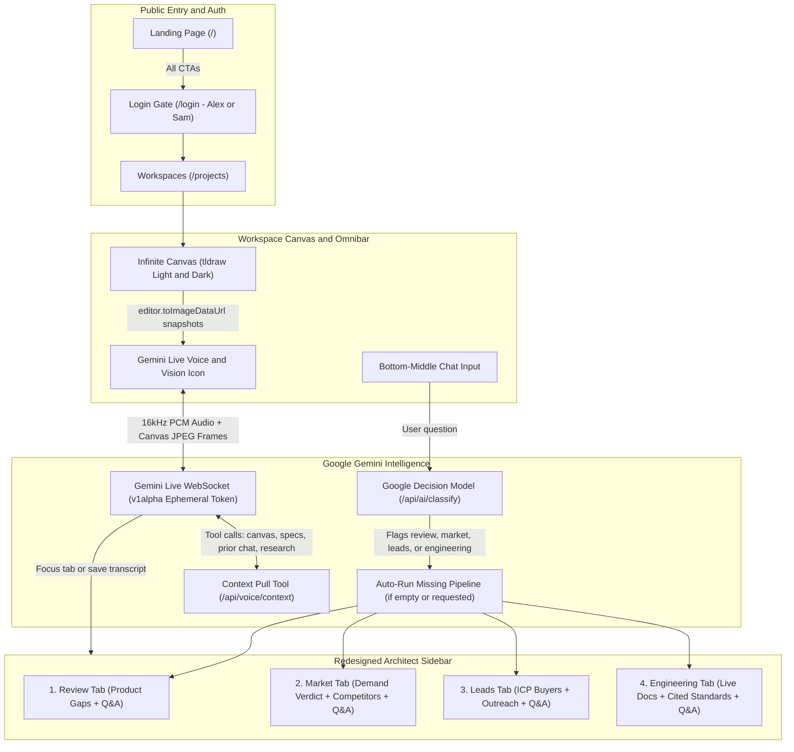

# Forma — UI Polish, Decision Omnibar, Gemini Live & Landing Page Plan

**Status:** Approved implementation plan  
**Related docs:** [`docs/plan.md`](./plan.md) · [`docs/deploy.md`](./deploy.md) · [`docs/demo_product.md`](./demo_product.md)

---

## Overview

With the core collaborative canvas, commercial research, grounding, and Cloud Run deploy workflows in place, this phase focuses on **functional clarity, multimodal intelligence, and flagship visual polish**:

1. **Architect Value-Proposition Redesign**: Reorganize the `Architect` sidebar around Forma's 4 pillars (`Review`, `Market`, `Leads`, `Engineering`) with live readiness indicators and clean read-only discussion feeds.
2. **Bottom-Middle Chat Omnibar + Google Decision Router**: Provide a single floating bottom-center input that classifies every question using a Google Gemini Decision model (`review | market | leads | engineering`), automatically runs missing research/grounding pipelines when needed, and streams the answer into the relevant output tab.
3. **Gemini Live Voice + Vision Co-Design**: Place a Gemini Live voice control adjacent to the bottom-center input that sees the canvas (`tldraw` snapshots), converses with low-latency bidirectional audio + barge-in, and pulls deeper context from the canvas or prior discussions via tool calls.
4. **Light & Dark Modes + Crisp UI Craft**: Replace hardcoded dark colors with a high-contrast semantic token system across every surface, modal, toolbar, semantic block, and `tldraw` canvas so everything is crisp and legible in both Light and Dark modes.
5. **Public Landing Page + `/login` Gate**: Introduce a dedicated marketing landing page at `/` where all CTAs lead to `/login` to choose `Alex Rivera` or `Sam Chen`.

---

## Architecture & User Flow

---

## 1. Light & Dark Theme System and Crisp Visual Polish

Replace hardcoded dark colors across the app with a high-contrast semantic token system so every text label, border, block card, floating control, and canvas element is crisp and legible in both Light and Dark modes.

- **Semantic Design Tokens (`src/app/globals.css`)**:
  - Define `:root` (crisp daylight palette: `#f6f7f9` canvas, `#ffffff` elevated surfaces, `#0f172a` primary ink, `#475569` readable secondary text, `#6d28d9` violet accent, subtle multi-layer shadows, and `rgba(15, 23, 42, 0.10)` hairline borders) and `.dark` (refined obsidian palette: `#0b0c10` background, `#13151b` elevated cards/sidebar, `#f3f4f6` primary text, `#9ca3af` secondary text, `#a78bfa` violet accent, `rgba(255, 255, 255, 0.10)` borders).
  - Add semantic surface and status tokens (`--surface`, `--surface-elevated`, `--surface-subtle`, `--surface-hover`, `--input-bg`, `--border-strong`, `--accent-soft`, `--success`, `--warning`, `--danger`, `--canvas-bg`, `--canvas-grid`) mapped via `@theme inline`.
  - Update `.forma-canvas` and `.forma-block` styles to use theme variables so semantic blocks (`screen`, `service`, `database`, `entity`, `decision`, `note`) have crisp card elevation, clear kickers, and high-contrast descriptions in both themes.
- **Theme Provider & Toggle (`src/components/theme-provider.tsx`, `src/app/layout.tsx`)**:
  - Add an inline initialization script in `src/app/layout.tsx` to apply `light` or `dark` before first paint (persisted under `localStorage["forma-theme"]` with system preference fallback).
  - Create `ThemeProvider` (`useTheme`) and a crisp `ThemeToggle` icon button placed in the Landing Page header, Login screen, `src/components/project-home.tsx`, and `src/components/workspace/top-nav.tsx`.
  - Sync `Sonner` `<Toaster>` theme dynamically with `useTheme()`.
- **Canvas & Component Polish (`src/components/workspace/canvas-stage.tsx`, `src/components/ui.tsx`)**:
  - Pass `colorScheme={theme}` to `<Tldraw>` and call `editor.user.updateUserPreferences({ colorScheme: theme })` on theme change so `tldraw` grid, arrows, selection, and native shapes adapt cleanly.
  - Audit and replace hardcoded dark classes (`bg-[#121318]`, `bg-[#14161b]`, `bg-[#0e0f12]`, `bg-black/20`, `bg-white/5`, `bg-white/10`) in `src/components/ui.tsx`, `src/components/workspace/top-nav.tsx`, `src/components/workspace/left-toolbar.tsx`, `src/components/workspace/bottom-bar.tsx`, `src/components/deploy/deploy-dock.tsx`, `src/components/workspace/presence.tsx`, and `src/components/project-home.tsx`.
  - Move the zoom/fit/status pill in `src/components/workspace/bottom-bar.tsx` from `bottom-center` to `bottom-left` (`left-3 bottom-3`) so the bottom-middle stage stays completely unobstructed for the new Chat + Gemini Live Omnibar.

---

## 2. Architect Sidebar Redesign & 4-Pillar Value Proposition

Restructure `src/components/workspace/ai-sidebar.tsx` so Forma's core value proposition—turning a sketch into validated product, market, buyer, and engineering decisions—is immediately clear and uncluttered.

- **Open by Default & Value-Proposition Framing (`src/components/workspace/workspace.tsx`, `src/components/workspace/ai-sidebar.tsx`)**:
  - Open `AiSidebar` by default on desktop viewports (`>= 1024px`) so users immediately see the Architect workflow upon entering a workspace.
  - Add a crisp **Architect Value Header & Readiness Strip** showing the 4 validation pillars with live completion indicators (dot/check badges when Review, Market, Leads, or Engineering artifacts exist) and a collapsible **Project Goal** card so reports and answers get maximum vertical space.
- **4 Clear Output Tabs + Contextual Component Inspector**:
  - Arrange workspace outputs into a crisp 4-tab segmented bar with icons and clear subtitles:
    - **`Review`** (`Product Gaps`): Severity-grouped findings (`critical`, `warning`, `suggestion`), 1-click **"Focus on canvas"** links, canvas proposals, and the `Review` discussion output feed (`blockKey = ""`).
    - **`Market`** (`Demand & Wedge`, `src/components/workspace/architect/market-tab.tsx`): Prominent Demand Verdict pill, Executive Summary, Recommended Wedge, Competitor cards, Kill Risks, 1-click decision proposals, and the `Market` discussion output feed (`blockKey = "__market__"`).
    - **`Leads`** (`Initial Buyers`, `src/components/workspace/architect/leads-tab.tsx`): Collapsible ICP brief builder, status filter pills, buyer cards with warm triggers, 1-click outreach copy, CSV export, and the `Leads` discussion output feed (`blockKey = "__leads__"`).
    - **`Engineering`** (`Docs & Rigor`, new `src/components/workspace/architect/engineering-tab.tsx`): Surfaces the existing `src/app/api/build/grounding/docs/route.ts` and `src/app/api/build/grounding/standards/route.ts` pipelines in the UI. Displays cited official SDK `DocPack` cards (verified imports, deprecations) and `StandardsPack` checklists mapped to canvas blocks (with click-to-focus block buttons), a **"Ground Docs & Standards"** button, and the `Engineering` discussion output feed (`blockKey = "__engineering__"`).
  - Preserve **Component Inspector** (`Discuss` + `Specification` editor) via a clean selected-block banner/pill whenever a block is selected or `Explore` is clicked on a canvas block.
  - Extract a clean read-only `src/components/workspace/architect/discussion-feed.tsx` component to render messages, streaming states, routing badges, and `ProposalList` items inside each output tab—removing the duplicate bottom textareas from individual sidebar tabs.
  - Extend `architectTab` in `src/lib/liveblocks.config.ts` and `src/components/workspace/collab-bridge.tsx` to include `"engineering"`.

---

## 3. Bottom-Middle Chat Omnibar & Google Decision Model Router

Build a central floating omnibar at the bottom-middle of the workspace where users ask any question about their app, classify it with a Google Gemini Decision model, auto-run missing pipelines when needed, and stream the answer in the flagged output tab.

- **Google Decision Model Classifier (`src/lib/ai/decision.ts` & `src/app/api/ai/classify/route.ts`)**:
  - Use `@google/genai` (`GEMINI_DECISION_MODEL` defaulting to `gemini-2.5-flash` with `temperature: 0`, `responseMimeType: "application/json"`, `responseJsonSchema`) to classify the prompt against project goal and canvas block titles into:
    - `tab`: `"review" | "market" | "leads" | "engineering"`
    - `shouldRunPipeline`: `boolean` (true if the user asks for fresh research/analysis or asks a domain question that depends on grounding)
    - `label`: concise 3–6 word intent badge (e.g., `"Market · Competitor pricing"`).
  - Include deterministic fallback via `loadArchitect().completeJson` if only OpenAI is configured.
- **Engineering & Review Grounding in Chat (`src/app/api/ai/chat/route.ts`, `src/lib/research/prompt-context.ts`)**:
  - Extend `mode` in `src/app/api/ai/chat/route.ts` to `"global" | "review" | "local" | "market" | "leads" | "engineering"`.
  - Update `researchPrompt` in `src/lib/research/prompt-context.ts` so `"review"` includes the latest saved `Analysis` findings and `"engineering"` injects saved `DocPack` (`docs`) and `StandardsPack` (`standards`) artifacts + citations + component specifications.
- **Unified Bottom-Middle Omnibar (`src/components/workspace/command-bar.tsx`)**:
  - Positioned at `bottom-4 left-1/2 -translate-x-1/2` with crisp glassmorphic surface, auto-sizing input, quick-ask starter pills on focus, live routing status indicator, submit button, and the adjacent Gemini Live button.
  - **Auto-Run + Answer Orchestration**:
    1. Posts question to `/api/ai/classify`.
    2. Opens `AiSidebar` and switches immediately to the classified tab (`review`, `market`, `leads`, or `engineering`), showing a subtle routing pill (`Flagged as Engineering`).
    3. Checks if that tab has no saved artifact yet (or `shouldRunPipeline` is true when explicitly requested):
       - `review`: triggers `POST /api/ai/analyze` if no analysis exists.
       - `market`: infers locale (`inferLocale` fallback to Helsinki, Finland) and runs `POST /api/ai/research/market` if no market report exists.
       - `leads`: drafts brief (`PUT /api/ai/research/leads`) and runs `POST /api/ai/research/leads` if no leads exist.
       - `engineering`: triggers `POST /api/build/grounding/docs` and `POST /api/build/grounding/standards` in parallel if no docs/standards packs exist.
       - Displays live progress directly inside the opened tab; if `CONTEXT_DEV_API_KEY` is unset, gracefully skips external lookup and proceeds to answer from canvas context.
    4. Streams the answer from `POST /api/ai/chat` into the target tab's conversation (`""`, `"__market__"`, `"__leads__"`, or `"__engineering__"`), persists via `PUT /api/conversations`, and fetches actionable canvas proposals via `POST /api/ai/canvas-proposals`.

---

## 4. Gemini Live Multimodal Voice & Vision Co-Design

Place a Gemini Live voice control right next to the bottom-middle chat input that sees the user's canvas in real time, speaks with low-latency bidirectional audio, and pulls deeper context from the canvas or prior discussions on demand.

- **Ephemeral Token Endpoint (`src/app/api/voice/token/route.ts`)**:
  - Server-only route verifying `getCurrentUser()` and minting a single-use `v1alpha` ephemeral token via `new GoogleGenAI({ apiKey: geminiKey, httpOptions: { apiVersion: "v1alpha" } }).authTokens.create(...)` so `GEMINI_API_KEY` never leaves the server. Returns `{ token, model }` (`GEMINI_LIVE_MODEL` defaulting to `gemini-2.5-flash-native-audio-preview-12-2025`).
- **On-Demand Context Endpoint (`src/app/api/voice/context/route.ts`)**:
  - Authenticated `POST` endpoint returning structured slices of workspace state when Gemini Live invokes a tool: saved `Specification`s, latest `Analysis`, `MarketReport`, `Leads`, `DocPack`, `StandardsPack`, and recent `conversations` across `review`, `market`, `leads`, `engineering`, and component threads.
- **Browser Multimodal Live Client (`src/lib/voice/gemini-live-client.ts` & `src/components/workspace/voice-control.tsx`)**:
  - Connects via `new GoogleGenAI({ apiKey: token, httpOptions: { apiVersion: "v1alpha" } }).live.connect(...)` with `responseModalities: [Modality.AUDIO]`, `inputAudioTranscription: {}`, `outputAudioTranscription: {}`, and concise Architect system instructions seeded with the project name, goal, and block overview.
  - **Bidirectional Audio + Barge-In**:
    - Captures 16kHz mono PCM mic audio via an `AudioWorklet` processor and streams via `session.sendRealtimeInput({ audio: { data, mimeType: "audio/pcm;rate=16000" } })`.
    - Schedules 24kHz PCM `modelTurn` audio chunks on `AudioContext` and immediately clears queued playback buffers on `serverContent.interrupted`.
  - **Live Canvas Vision ("See and Discuss")**:
    - Exports the current `tldraw` canvas using `editor.toImageDataUrl(shapes, { format: "jpeg", quality: 0.72, scale: 0.9, background: true })` and sends base64 frames via `session.sendRealtimeInput({ video: { data, mimeType: "image/jpeg" } })` on session connect and (debounced ~1.5s) whenever canvas shapes, connections, or selection change—allowing Gemini Live to visually inspect layout, arrows, notes, and selected blocks as the user speaks.
  - **Dynamic Context Pulling via Function Declarations**:
    - `get_canvas_details`: Reads live `extractCanvas(editor)` blocks, arrows, current selection, and saved component specifications.
    - `get_workspace_context`: Calls `/api/voice/context` to pull prior discussion history (`review`, `market`, `leads`, `engineering`, or `component`) and saved research/engineering summaries whenever deeper context is needed.
    - `navigate_workspace`: Switches the Architect sidebar to `review`, `market`, `leads`, or `engineering`, or selects and zooms to a specific `blockId` on the canvas while discussing it.
  - Syncs finalized user and assistant spoken transcripts back to `/api/conversations` and updates Liveblocks `voiceState` presence (`idle | listening | speaking`).

---

## 5. Public Landing Page & `/login` Gate

Give Forma a flagship marketing landing page at `/` while routing all entry CTAs through `/login` to choose a demo collaborator (`Alex Rivera` or `Sam Chen`).

- **Routing Updates (`src/app/page.tsx`, `src/app/login/page.tsx`, `src/app/projects/page.tsx`, `src/app/w/[projectId]/page.tsx`)**:
  - `src/app/page.tsx`: Render `<LandingPage isSignedIn={Boolean(user)} />` at `/`. All primary CTAs (`Get started`, `Sign in`, `Open demo`) route to `/login` (with a secondary `Workspaces` nav button when a session already exists).
  - `src/app/login/page.tsx`: Render `<LoginScreen next={next} />` (redirecting to `safeNextPath` if already authenticated), enhanced with `ThemeToggle` and a back-link to `/`.
  - Update unauthenticated redirects in `src/app/projects/page.tsx` and `src/app/w/[projectId]/page.tsx` to `/login` (`?next=...`).
- **Landing Page Design (`src/components/landing-page.tsx`)**:
  - Designed for maximum clarity and visual craft in both Light and Dark modes:
    - **Top Bar**: `Logo`, section links (`Workflow`, `Architect`, `Gemini Live`, `Deploy`), `ThemeToggle`, and `Sign in` / `Start designing` button -> `/login`.
    - **Hero Section**: Clear value headline (*"Draw the product. Prove the business. Deploy it live."*), concise pitch, CTA buttons to `/login`, and a high-detail interactive **Workspace Preview Stage** illustrating semantic canvas blocks, live collaborator cursors, the bottom-middle Decision Chat + Gemini Live bar, and the 4-tab Architect sidebar.
    - **4-Pillar Architect Bento Grid**: Visual breakdown of `1. Product Review`, `2. Live Market Truth`, `3. Real Buyer Leads`, and `4. Cited Engineering Rigor`.
    - **Gemini Live + Cloud Run Deploy Section**: Highlights multimodal visual/voice co-design, automatic Google Decision routing, real-time multi-cursor sync, and one-click Cloud Run deployment.
    - **Closing CTA Banner & Footer**: Direct link to `/login`.

---

## 6. File Blueprint & Implementation Checklist

### New & Updated Files
- `src/app/globals.css` — Light & Dark semantic CSS variables, `.forma-canvas`, and `.forma-block` styles.
- `src/components/theme-provider.tsx` — `ThemeProvider`, `useTheme`, and `ThemeToggle`.
- `src/app/layout.tsx` — Pre-hydration theme script, `ThemeProvider`, and dynamic `Toaster` theme.
- `src/app/page.tsx` & `src/components/landing-page.tsx` — Public marketing landing page.
- `src/app/login/page.tsx` & `src/components/login-screen.tsx` — Dedicated `/login` gate for `Alex Rivera` and `Sam Chen`.
- `src/components/workspace/ai-sidebar.tsx` — 4-pillar Architect layout (`Review`, `Market`, `Leads`, `Engineering`), readiness indicators, and Component inspector.
- `src/components/workspace/architect/engineering-tab.tsx` — Live SDK `DocPack` + cited `StandardsPack` UI wired to `/api/build/grounding/{docs,standards}`.
- `src/components/workspace/architect/discussion-feed.tsx` — Shared read-only Q&A stream and canvas proposal feed per tab.
- `src/lib/ai/decision.ts` & `src/app/api/ai/classify/route.ts` — Google Gemini Decision classifier (`review | market | leads | engineering`).
- `src/components/workspace/command-bar.tsx` — Bottom-middle Chat omnibar + auto-run orchestrator + adjacent Gemini Live button.
- `src/app/api/voice/token/route.ts` & `src/app/api/voice/context/route.ts` — `v1alpha` ephemeral token minting and workspace context lookup for Gemini Live.
- `src/lib/voice/gemini-live-client.ts` & `src/components/workspace/voice-control.tsx` — WebAudio 16kHz/24kHz PCM + barge-in, `tldraw` JPEG canvas frames, and Live tool calls.

### Implementation Tasks
- [ ] **1. Theme & UI Polish**: Implement Light/Dark token system in `globals.css`, `ThemeProvider` + `ThemeToggle`, `tldraw` `colorScheme` sync, bottom-left zoom bar relocation, and high-contrast polish across all components.
- [ ] **2. Architect Redesign & Engineering Tab**: Restructure `AiSidebar` around `Review`, `Market`, `Leads`, and `Engineering` with readiness indicators and `DiscussionFeed`.
- [ ] **3. Decision Router & Bottom-Middle Omnibar**: Build `/api/ai/classify`, extend `/api/ai/chat` + `prompt-context.ts` for `engineering` and `review`, and wire `CommandBar` with missing-report auto-execution.
- [ ] **4. Gemini Live Voice & Vision**: Build `/api/voice/token`, `/api/voice/context`, `gemini-live-client.ts`, and `VoiceControl` next to the bottom-middle chat input.
- [ ] **5. Landing Page & `/login` Route**: Ship `LandingPage` at `/`, move `LoginScreen` to `/login`, and update unauthenticated redirects.
- [ ] **6. Verification**: Add unit tests (`node --experimental-strip-types --test`), update `.env.example` and `README.md`, and pass `npm run test`, `npm run typecheck`, `npm run lint`, and `npm run build`.
